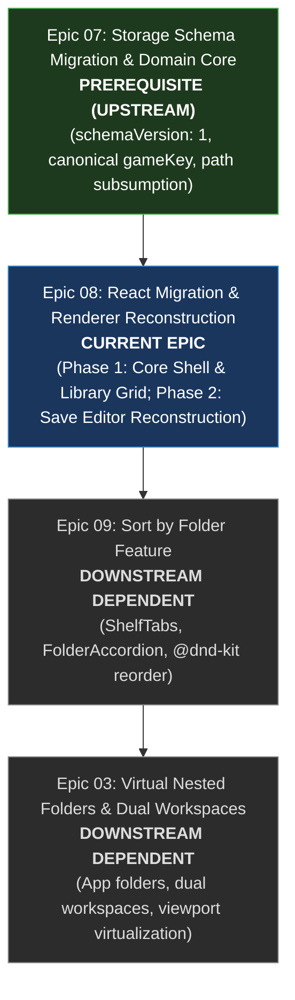
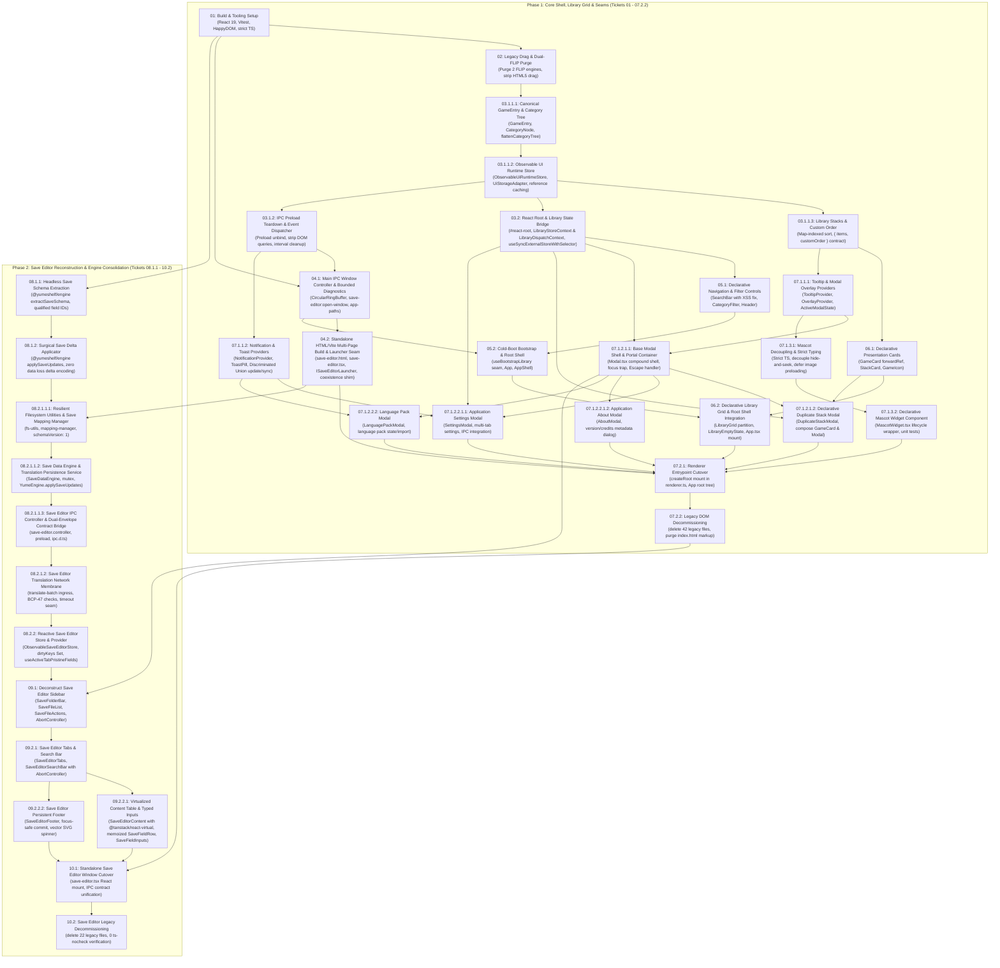

# PRD: React Migration & Renderer Reconstruction

## 1. Overview & Objective

Completely reconstruct YumeShelf's renderer from raw imperative DOM manipulation and untyped JavaScript to a modern, declarative React 19 architecture, eliminating 100% of frontend technical debt, dual-FLIP animation conflicts, listener/timer memory leaks, the 1,015-line save editor sidebar monolith, all shadow engine duplicates in the renderer, and all `// @ts-nocheck` directives across `src/`.

### Core Problem & Architectural Rationale
An exhaustive architectural audit across specialized review tracks revealed that the current renderer is in **Bad State (Preparatory Refactoring Required)**:
1. **Suppressed Type Checking**: 62 frontend files in `src/renderer/` (plus `src/renderer.ts`, `src/shared/types/ipc.d.ts`, and `src/shared/types/save-editor.d.ts`, totaling 65 files across `src/`) begin with `// @ts-nocheck`. The frontend is effectively untyped JavaScript disguised with `.ts` extensions, leaving compiler verification disabled.
2. **Shadow Engine Duplication in Renderer**: Despite the existence of `@yumeshelf/engine`, `src/renderer/` contains zero imports of `@yumeshelf/engine`. Instead, `src/renderer/save-editor/` implemented its own parallel shadow engine layer (`data-engine.ts` plus 7 custom engine files in `src/renderer/save-editor/engines/`) that sniffs properties, guesses engine types, and recursively traverses objects in client-side JavaScript. This violates the Single Source of Truth invariant in [`AGENTS.md`](file:///d:/Projects/YumeShelf/AGENTS.md).
3. **Dual-FLIP Animation Race Condition**: Two independent, competing FLIP implementations exist simultaneously: manual CSS transform calculations in [`src/renderer/utils/flip-animation.ts`](file:///d:/Projects/YumeShelf/src/renderer/utils/flip-animation.ts) and Web Animations API calls (`captureCardRects` & `animateReorderedCards`) inside [`src/renderer/library-grid.ts`](file:///d:/Projects/YumeShelf/src/renderer/library-grid.ts). When reordering, both engines race and mutate elements concurrently.
4. **IPC State & DOM Thrashing**: [`src/renderer/events/ipc-events.ts`](file:///d:/Projects/YumeShelf/src/renderer/events/ipc-events.ts) mutates in-memory object references in place, queries the DOM with `querySelectorAll` to overwrite textContent directly, and then immediately triggers a full grid wipe and re-render via `sortGames()`. Furthermore, `bindIpcEvents` provides zero teardown/unsubscribe handles, leaking listeners.
5. **Passive State Store**: [`src/renderer/state/ui-runtime-state.ts`](file:///d:/Projects/YumeShelf/src/renderer/state/ui-runtime-state.ts) is a closure without `subscribe(listener)` or `getSnapshot()` methods, making clean integration with React 19's `useSyncExternalStore` impossible without an observable store refactoring.
6. **Static DOM Bloat & Global Listener Pollution**: [`src/index.html`](file:///d:/Projects/YumeShelf/src/index.html) embeds 500 lines of static markup for 9 separate subsystems, forcing [`src/renderer/bootstrap/dom-refs.ts`](file:///d:/Projects/YumeShelf/src/renderer/bootstrap/dom-refs.ts) to query ~150 distinct element IDs. [`src/renderer/tooltips.ts`](file:///d:/Projects/YumeShelf/src/renderer/tooltips.ts) attaches 7 permanent document/window listeners with no `destroy()` method.
7. **Save Editor Monolith & Ingress Breach**: [`src/renderer/save-editor/sidebar.ts`](file:///d:/Projects/YumeShelf/src/renderer/save-editor/sidebar.ts) contains a 922-line procedural function (`setupSidebar`) with cyclomatic complexity > 300 and 14 nesting levels. Dirty checking runs synchronous `JSON.stringify` over 5MB to 50MB saves on every keystroke, and [`src/renderer/save-editor/translator.ts`](file:///d:/Projects/YumeShelf/src/renderer/save-editor/translator.ts) executes raw `fetch()` calls to external Google Translate endpoints directly from the browser renderer.

To establish a clean, robust foundation for Epic 09 (Sort by Folder) and downstream epics, this epic executes a 2-phase reconstruction across 37 modular tickets (24 in Phase 1 and 13 in Phase 2), establishing `@yumeshelf/engine` as the sole headless engine and reducing the Renderer to 100% pure presentation.

### Coexistence Architecture During Migration
To ensure zero regression and keep `npm run typecheck` clean throughout the transition, the migration follows the `Expand -> Contract -> Delete` lifecycle:
- In Phase 1 (Tickets 01–07.1.3), new declarative React components and context providers are developed and unit-tested in isolation using in-memory Vitest harnesses while legacy procedural DOM controllers continue running the active application runtime.
- In Ticket 07.2.1, the composition root cuts over atomically: `src/renderer.ts` mounts `<App />` into `#react-root` via `createRoot`, and in Ticket 07.2.2 43 obsolete legacy procedural files are decommissioned and permanently deleted (retaining `i18n-binder.ts`, `markdown-lite.ts`, and `ui/toast-pill.ts` until Ticket 10.2 for save-editor coexistence).
- In Phase 2, Save Editor React components are constructed alongside legacy procedural save files with transitional IPC dual-envelopes in Ticket 08.2.1.1, and all 22 remaining legacy save-editor files, orphaned utilities, and shadow types are contracted and retired in Ticket 10.2 upon verified standalone React cutover in Ticket 10.1.

---

## 2. Dependency Lineage

- **Upstream Prerequisite**: [Epic 07 (Storage Schema Migration & Domain Core)](file:///d:/Projects/YumeShelf/docs/specs/07-storage-schema-migration-and-domain-core/PRD.md).
- **Downstream Dependents**: [Epic 09: Sort by Folder (@dnd-kit)](file:///d:/Projects/YumeShelf/docs/specs/09-sort-by-folder/PRD.md) and [Epic 03 (Virtual Nested Folders & Dual Workspaces)](file:///d:/Projects/YumeShelf/docs/specs/03-virtual-nested-folders-and-workspaces/PRD.md).

---

## 3. 2-Phase Execution Architecture

### Critical Path Analysis

- **Primary Critical Path**:
  `T01 (Tooling Setup) -> T02 (Tech Debt Purge) -> T03.1.1.1 (GameEntry & CategoryTree) -> T03.1.1.2 (Observable Store) -> T03.2 (React Root Bridge) -> T05.1 (Nav & Filters) -> T05.2 (Boot & Shell) -> T06.2 (Library Grid) -> T07.2.1 (Cutover) -> T07.2.2 (Legacy DOM Decommissioning) -> T10.1 (Save Editor Cutover) -> T10.2 (Legacy Save Decommissioning)`.
  `T01` introduces `src/shared/path-sanitizer.ts` as the foundational privacy sanitizer for upstream and downstream consumers (`T03.1.2`, `T04.1`, `T05.2`, `T06.2`, `T07.1.2.2.1.1`, `T07.2.1`, `T08.2.1.1.1`, `T08.2.1.1.2`, `T08.2.1.1.3`, etc.). `T04.1` branches from `T03.1.2` (which branches from `T03.1.1.2`) and converges downstream at `T05.2` (providing `registerGlobalErrorSanitizer` and window controller diagnostics), `T04.2 -> T07.2.1` (for the main cutover), and `T08.2.1.1.1` (for the Save Editor persistence pipeline). `T07111 -> T071211` branches from `T03.1.1.3` in parallel with `T03.2 -> T05.1 -> T05.2 -> T06.2`. `T07.1.2.1.1` (Base Modal Shell) unlocks `T07.1.2.1.2` (Duplicate Stack Modal), `T07.1.2.2.1.1` (Settings Modal), `T07.1.2.2.1.2` (About Modal), and `T07.1.2.2.2` (Language Pack Modal) in parallel. Sibling modals consume `T07.1.1.2` (notifications, branching from `T03.1.2`), while `T07.1.2.1.1` (Base Modal Shell), `T07.1.2.1.2` (Duplicate Stack Modal), and `T07.1.2.2.1.1` (Settings Modal) converge with `T03.2` for portal mounting, live stack resolution, and state hydration before uniting at cutover `T07.2.1`.
- **Secondary Parallel Branches**:
  - *Save Editor Pipeline*: `T04.2 (Entrypoint Seam) + T08.1.1 (Schema Extraction) -> T08.1.2 (Delta Applicator) -> T08.2.1.1.1 (Resilient FS & Mappings) -> T08.2.1.1.2 (Save Engine & Translations) -> T08.2.1.1.3 (IPC Bridge & Contracts) -> T08.2.1.2 (Translation Membrane) -> T08.2.2 (Save Store) + T07.1.2.1.1 (Base Modal Shell) -> T09.1 (Sidebar) -> T09.2.1 (Tabs & Search) -> T09.2.2.1 (Virtualized Content) & T09.2.2.2 (Persistent Footer) -> T10.1 -> T10.2`.
  - *Cards & Stacks Pipeline*: `T03.1.1.1 -> T03.1.1.2 -> T03.1.1.3 (Stacks & Custom Order) -> T06.1 (Presentation Cards) -> T06.2 (Library Grid) & T07.1.2.1.2 (Duplicate Stack Modal) -> T07.2.1`.
  - *Mascot Pipeline*: `T07.1.1.1 -> T07.1.3.1 (Mascot Decoupling) -> T07.1.3.2 (Mascot Component) -> T07.2.1`.

---

## 4. Scope & Architectural Boundaries

### In Scope

#### Phase 1: Core Shell, Library Grid & Seams (Tickets 01 - 07.2.2)
1. **Tooling & Strict TS Baseline (Ticket 01)**: Install React 19, `@vitejs/plugin-react` (`^6.0.0`), Vitest (`vitest: ^5.0.3`) with `@testing-library/react`, `@testing-library/user-event`, and HappyDOM. Introduce `src/shared/path-sanitizer.ts` (`sanitizeUserPaths`) and `src/shared/path-sanitizer.test.ts` as foundational cross-process privacy sanitizers with zero Node native dependencies. Author `vitest.config.ts` specifying multi-project isolation via `test.projects` (`renderer` on `happy-dom` with `vitest.setup.renderer.ts` and `main` on `node` with `vitest.setup.node.ts`) and `resolve.alias` mirroring `tsconfig.json` path aliases (`@yumeshelf/engine` pointing to `packages/yume-engine/src/index.ts` and `@yumeshelf/engine/types` pointing to `packages/yume-engine/src/types.ts`). Configure the `ban-engine-runtime-in-renderer` Vite build guard plugin failing fatally if runtime engine modules or browser-external shims are bundled into `dist/renderer/`. Enforce strict compiler checks and ratcheted baseline check for `// @ts-nocheck` directives (<= 65 files) via cross-platform npm script `"verify:no-ts-nocheck"`.
2. **Animation & Drag Purge (Ticket 02)**: Delete `drag-math.ts` and `flip-animation.ts`. Strip the second Web Animations API FLIP engine from `library-grid.ts`. Purge all native HTML5 drag listeners (`ondragstart`, `ondragover`, `draggable`) from `game-cards.ts`, `stack-cards.ts`, `library-grid.ts`, and `search.ts`.
3. **Observable State Store, Canonical GameEntry & Clean IPC Teardown (Tickets 03.1.1.1, 03.1.1.2, 03.1.1.3 & 03.1.2)**:
   - In Ticket 03.1.1.1 ($S$): Define canonical `GameEntry` interface in `src/renderer/types/game.ts` aligning with `StoredGameRecord.name`, stack instance fields (`relativePath`, `instanceId`, `primaryInstance`), runtime flags (`runInBackground`, `autoTranslate`), and location annotation fields (`locationLabel`, `parentLocationLabel`, `relativePathDisplay`, `fullLocationLabel`, `relativePathFullDisplay`). Define canonical `CategoryNode`, `FlattenedCategoryItem`, and `flattenCategoryTree` in `src/renderer/domain/category-tree.ts`. Export canonical annotation helpers `buildDuplicateChipLabel` and `buildPathSubtitle` in `src/renderer/game-annotations.ts`. Remove `// @ts-nocheck` and enforce strict typing across `category-tree.ts`, `game.ts`, `formatting.ts`, `formatting.test.ts`, and `game-annotations.ts`.
   - In Ticket 03.1.1.2 ($S$): Upgrade `ui-runtime-state.ts` to implement `subscribe(listener)`, `getSnapshot()`, immutable `updateGame(gameKey, patch)` with snapshot reference stability caching (`Object.is(store.getSnapshot(), store.getSnapshot()) === true`), `UiStorageAdapter` dependency injection seam (persisting `yumeshelf_sort_pref` and `yumeshelf_active_category_id`), and `basePlaytime` teardown on `setGameRunning(key, false)`. Remove `// @ts-nocheck` from `ui-runtime-state.ts` and `ui-runtime-state.test.ts`.
   - In Ticket 03.1.1.3 ($S$): Implement Map-indexed custom sort in `src/renderer/library-order.ts` (`resolveCustomOrder`, `readStoredCustomOrder`). Implement `buildLibraryViewItems` returning `{ items: readonly LibraryViewItem[], customOrder?: readonly string[] | null }` with `favorite: boolean` in `src/renderer/library-stacks.ts`. Remove `// @ts-nocheck` from `library-order.ts` and `library-stacks.ts`.
   - In Ticket 03.1.2 ($S$): Update `src/preload.ts` and `src/shared/types/ipc.d.ts` so that listener subscription methods return explicit `() => void` unsubscribe functions. Decouple IPC event handlers in `ipc-events.ts` from DOM mutations, re-annotating games via `annotateGamesForDisplay` on game stopped/playtime/config updates, and returning clean disposal/teardown functions. Update `src/renderer.ts` caller symmetrically and retain bootstrap placeholder interval teardown.
4. **React Root Mounting & Library State Context Bridge (Ticket 03.2)**:
   - Add `

` to `src/index.html`.
   - Implement `LibraryStateContext.tsx` segregating referentially stable `LibraryStoreContext` and action-oriented `LibraryDispatchContext`, alongside granular selector hooks powered by `useSyncExternalStoreWithSelector` (`useAllGames`, `useCurrentSort`, `useActiveCategoryId`, `useCategoryTree`, `useSearchableGames`, `useLocationDisplayMode`, `useLibraryDispatch`, `useLibraryState`) providing typed reactive bridge to `useSyncExternalStore` with an injectable `store` parameter seam.
5. **Save Editor Seam Isolation & Bounded Diagnostics (Tickets 04.1 & 04.2)**:
   - Extend `src/shared/path-sanitizer.ts` (established in Ticket 01) to export `registerGlobalErrorSanitizer` providing global window error and unhandled rejection event listener sanitization with deterministic teardown, alongside memory-bounded `CircularRingBuffer` in `src/shared/ring-buffer.ts`.
   - In `src/main/window/main-window.ts`, sanitize all startup path diagnostics and directory probe failure error payloads in `logStartupDiagnostics` via `sanitizeUserPaths`, enforce `webPreferences.sandbox: true`, configure navigation security controls `setWindowOpenHandler` and `will-navigate` (enforcing root-safe boundary delimiter checks `allowedDir.endsWith(path.sep) ? allowedDir : \`${allowedDir}\${path.sep}\``, platform-aware case sensitivity, Vite dev server origin bypass, and safe `shell.openExternal` delegation), and attach `render-process-gone` crash recovery handling (`isQuitting` normal shutdown suppression, `reason === 'clean-exit'` clean termination, and unexpected crash dialog offering Relaunch or Exit with tray/handle cleanup), verified in `src/main/window/main-window.test.ts`.
   - Remove `?mode=save-editor` bifurcation from `src/renderer.ts`.
   - Create `src/save-editor.html` and configure Vite multi-page build referencing canonical entrypoint `src/save-editor.tsx`, using top-level `await import()` to guarantee window flags execute before module evaluation.
   - Update `AppPathsInstance` in `src/main/core/app-paths.ts` to resolve `saveEditorHtmlPath` across development and packaged production.
   - Introduce `ISaveEditorLauncher` interface and `ElectronSaveEditorLauncher` adapter dispatching symmetrical IPC `'save-editor:open-window'` with query options `{ search: ... }`, updating `save-editor.controller.ts` (including window restoration via `.restore()`, `!win.isDestroyed()` guard, handle cleanup on `'closed'`, and `diagnosticBufferCapacity?: number` seam) and `save-editor.controller.test.ts`.
   - Preserve `window.showSaveEditor` as a backward-compatible forwarding shim encapsulated inside `initSaveEditorUI(launcher)` with dependency injection and dual-factor standalone detection (`window.__IS_STANDALONE_SAVE_EDITOR__ === true`, URL pathname containing `save-editor`, or query parameter containing `gameKey=`) in `save-editor-ui.ts` during Phase 1 coexistence until legacy card controllers are decommissioned, preventing recursive window launching loops in standalone child windows.
6. **Declarative Navigation, Filter Controls & Core Shell (Tickets 05.1 & 05.2)**:
   - In Ticket 05.1 ($B$): Implement `SearchBar.tsx` (sanitizing text to eliminate HTML concatenation XSS and accepting optional `games` prop), `CategoryFilter.tsx` (consuming `CategoryNode` and `flattenCategoryTree` from `src/renderer/domain/category-tree.ts` with `title` hover tooltips), and `Header.tsx` (with explicit modal action callbacks, visible text labels alongside vector SVGs for domain actions via `.header-text-btn`, `.header-btn-icon`, and `.header-btn-label`, and canonical "Refresh Library" rescan button with `.is-refreshing` spinner animation and `aria-busy="true"`). Update `src/styles/header-search.css`.
   - In Ticket 05.2 ($B$): Implement `useBootstrapLibrary(store, api)` hook in `src/renderer/hooks/useBootstrapLibrary.ts` orchestrating startup cold boot via `bootstrapApp` / `getGames` with injectable `electronAPI` seam, hydrating `store.setCurrentLibraryConfig(config)`, annotating games via `annotateGamesForDisplay`, returning `BootstrapState` discriminated union (exposing `refresh: () => Promise<void>` and `isRefreshing: boolean` under `status === 'success'` with in-flight re-entrancy lock and non-unmounting background rescan semantics), and hydrating both games and category tree in store. Implement React `App.tsx` (mounting `LibraryStateProvider` unconditionally at root, composing internal layout component `AppShell` evaluating `bootstrapState.status`, rendering startup loading and update states composing verified `.loading-overlay` and `.loading-panel` hierarchy from `src/styles/boot.css` to eliminate unstyled `.app-loading-skeleton` and startup CLS, propagating `electronAPI?: ElectronAPI` seam).
7. **Declarative Cards & Library Grid (Tickets 06.1 & 06.2)**:
   - In Ticket 06.1 ($B$): Implement `GameCard.tsx` with `React.forwardRef<HTMLDivElement, GameCardProps>`, rendering `game.name`, handling `onToggleFavorite` strictly via presentation callback, and spreading `{...rest}` attributes for Epic 09 `@dnd-kit` compatibility. Implement `StackCard.tsx` typed with `stack: LibraryViewItem` and `onOpenStack?: (stack: LibraryViewItem) => void` presentation callback (decoupled from modal overlays). Implement lazy `GameIcon.tsx`. Blocked by `03.1.1.3`.
   - In Ticket 06.2 ($B$): Implement `LibraryGrid.tsx` resolving global custom sort order via `resolveCustomOrder(allGames)` without storage mutation side-effects, invoking `buildLibraryViewItems(visibleGames, currentSort, customOrder)`, partitioning favorites/non-favorites, conditionally rendering `<StackCard />` vs `<GameCard />`, orchestrating favorite toggle mutations with immediate optimistic local store updates, transactional rollback on IPC rejection or boolean desynchronization, and optional parameter seam `onFavoriteError?: (error: Error, gameKey: string) => void` (decoupled from Phase 7 `NotificationProvider`), and handling empty states (`LibraryEmptyState.tsx` exporting `FilteredEmptyState` styled via `src/styles/game-cards.css` with `min-height: 280px`) with onboarding CTAs. Mount `<LibraryGrid />` within `App.tsx`. Blocked by `06.1` and `05.2`.
8. **Modal Portals, Global Listener Providers & Mascot Decoupling (Tickets 07.1.1.1, 07.1.1.2, 07.1.2.1.1, 07.1.2.1.2, 07.1.2.2.1.1, 07.1.2.2.1.2, 07.1.2.2.2, 07.1.3.1 & 07.1.3.2)**:
   - In Ticket 07.1.1.1 ($S$): Consume the tokenized design system elevation scale established in Ticket 01 :root (--zIndex-dropdown through --zIndex-toast) with local stacking context containment (isolation: isolate) across tooltip, overlay, and notification containers. Encapsulate tooltips in a single TooltipProvider (destroying 7 leaky listeners). Implement OverlayProvider (LIFO modal stack state machine `modalStack`, pure selectors `isModalOpen` and `getModalPayload`, focus trapping, Escape key listener, and strongly typed ActiveModalState discriminated union / ModalPayloadMap storing scalar identifier { groupKey: string } for duplicate stacks).
   - In Ticket 07.1.1.2 ($S$): Implement `NotificationProvider` (strongly-typed `AppUpdateNotification` with strict Discriminated Union `update-available`, `update-downloaded`, `update-error`, `download-progress`, `parseAppUpdatePayload` ingress parser, `parseTranslationStatusPayload` ingress parser, auto-dismissing and terminal translation sync banners, and `<ToastPill />`). Blocked by `01` and `03.1.2`.
   - In Ticket 07.1.2.1.1 ($S$): Implement reusable compound `<Modal />` container component (`<Modal.Header>`, `<Modal.Body>`, `<Modal.Footer>`) portaled into `#portal-root` (with `document.body` fallback), binding strictly to `--zIndex-modal`, focus trapping, backdrop click dismissal, and Escape key handling.
   - In Ticket 07.1.2.1.2 ($B$): Implement declarative `DuplicateStackModal` composing `<Modal />` and `<GameCard />`, accepting optional `containerRef?: React.RefObject<HTMLDivElement | null>` with defensive fallback resolution and `groupKey?: string | null` to reactively resolve the stack via `resolveStackByGroupKey(allGames, groupKey)` or optional static `stack?: LibraryViewItem | null` prop. Decouple store subscriptions from closed modals via `DuplicateStackModalContent` mounted only when `isOpen === true`, synchronizing `onClose()` on unresolvable stack state via `useEffect`.
   - In Tickets 07.1.2.2.1.1 ($B$) & 07.1.2.2.1.2 ($B$): Implement declarative application dialog modals (`SettingsModal` and `AboutModal`) composing `<Modal />`.
   - In Ticket 07.1.2.2.2 ($B$): Implement declarative `LanguagePackModal` composing `<Modal />` with language pack import and state management.
   - In Ticket 07.1.3.1 ($S$): Remove `// @ts-nocheck` and strictly type `mascot-widget.ts`, eliminate module-load time `new Image()` preloading, fix click listener leak in `destroy()`, and inline/relocate `getNextShuffledIndex` to decouple from `features/hide-and-seek.ts`. Blocked by `01`.
   - In Ticket 07.1.3.2 ($B$): Implement declarative `<MascotWidget />` in `src/renderer/components/MascotWidget.tsx` managing `createMascotWidget` lifecycle via `useEffect` (`init()` on mount, `destroy()` on unmount) with unit tests in `MascotWidget.test.tsx` and `@media (prefers-reduced-motion: reduce)` motion reduction parity in `src/styles/mascot.css`.
9. **Renderer Entrypoint Cutover & Legacy Decommissioning (Tickets 07.2.1 & 07.2.2)**:
   - In Ticket 07.2.1 ($B$): Assemble complete `App.tsx` root tree (wrapping with `AppErrorBoundary` with `isCopied` state and styled via `src/styles/base.css` using verified design tokens `var(--bg-color)`, `var(--card-bg)`, `var(--text-main)`, `var(--border-color)`, `LibraryStateProvider`, `TooltipProvider`, `OverlayProvider`, and `NotificationProvider`, preserving `useBootstrapLibrary(store, api)` cold-boot branching inside `AppShell`, and mounting `<MascotWidget />`). Wire `Header` modal triggers and `onRefreshLibrary={bootstrapState.refresh}` / `isRefreshing={bootstrapState.isRefreshing}`. In game deletion confirmation modal, wire `duplicateStackContainerRef` fallback focus to eliminate focus drops to `document.body`, and enforce `aria-disabled={isDeletingGame}` and pointer suppression instead of native HTML `disabled` to preserve keyboard focus on active controls. Mount modals via stack-aware `isModalOpen()` preserving parent modal mount and focus context on submodal dismissal, wire `StackCard`'s `onOpenStack` callback to open `DuplicateStackModal` via `OverlayProvider` with scalar `groupKey` payload, conditionally mounting modals via `isModalOpen('duplicate-stack')`, `DuplicateStackModal` resolving the live stack reactively from `useAllGames()` via `resolveStackByGroupKey(allGames, groupKey)`, `GameCard`'s `onOpenSaveEditor` to `resolvedLauncher`, surfacing user-facing failure feedback via `showToast` when window launching rejects or when `api.startTranslationSync` rejects during `'tl-sync'`, and game launching via `api.launchYume({ gameKey, exePath, runInBackground })`. Wire `onFavoriteError` to `showToast('Failed to update favorite status')` with `useCallback([showToast])` referential stability. Symmetrically propagate injected `electronAPI?: ElectronAPI` and `launcher?: ISaveEditorLauncher` across `App` and `AppShell`. Remove `// @ts-nocheck` from `src/renderer.ts`, instantiate `store = createUiRuntimeState()`, mount `App.tsx` via `createRoot`, and bind IPC events with window beforeunload unbind.
   - In Ticket 07.2.2 ($S$): Permanently delete 43 replaced legacy procedural files: `dom-refs.ts`, `app-composition.ts`, `global-events.ts`, `lifecycle/bootstrap.ts`, `boot.ts`, `startup.ts`, `library-grid.ts`, `game-cards.ts`, `stack-cards.ts`, `library/runtime.ts`, `drag-drop-grid.ts`, `duplicate-stack-overlay.ts`, `search.ts`, `category-filter.ts`, `tooltips.ts`, `ui-text.ts`, `card-dropdown.ts`, `dropdown-icons.ts`, `quick-folder.ts`, `settings.ts`, `hide-and-seek.ts`, `cascading-submenus.test.ts`, `icon-payload.ts`, `icon-payload.test.ts`, `game-cards-cleanup.test.ts`, `i18n.ts`, `language-packs.ts` (and 4 subfiles), `app-updates.ts` (and 4 update subfiles), `update-notification-feature.ts`, `update-notifications.ts`, `update-notification-presets.ts`, `post-update-preferences.ts`, and `notifications/` (3 files). Purge 500 lines of obsolete static markup from `src/index.html`, retaining `https://translate.googleapis.com` in `<meta>` `connect-src` during Phase 1 for coexistence with legacy save-editor `translator.ts`.

#### Phase 2: Save Editor Reconstruction & Engine Consolidation (Tickets 08.1.1 - 10.2)
10. **Headless Save Schema Extraction in @yumeshelf/engine (Ticket 08.1.1)**:
    - Consolidate all save schema extraction into `@yumeshelf/engine` via `YumeEngine.extractSaveSchema(strategy, rawData, options?: SaveCodecOptions)` returning `NormalizedSaveDto`, consuming `options.metadata` with defensive scalar coercion, normalizing field labels to Unicode NFC ('NFC'), assigning canonical strategy (`normalizeSaveStrategy(strategy)`), and normalizing uninitialized raw values to default scalars.
    - Define and export canonical DTO contracts (`NormalizedSaveDto`, `SaveTabDto`, `SaveFieldDto`, `EngineLogger`), save strategy types (`CanonicalSaveStrategy`, `ShorthandSaveStrategy`, `SupportedSaveStrategy`), and strategy normalization utilities (`STRATEGY_CANONICAL_MAP` null-prototype dictionary and `normalizeSaveStrategy`) directly in `packages/yume-engine/src/types.ts` and `save-codecs/index.ts`, and re-export from `packages/yume-engine/src/index.ts`, establishing the `@yumeshelf/engine/types` path for type-only consumption. Enforce Zero Stream Pollution across all codecs with BYO-Logger seam `options.logger` wrapped in `safeLog` and `SaveCodecError` cause chaining (`{ cause }`).
    - Enforce deterministically qualified `SaveFieldDto.id: `${tabId}:${key}`` to prevent cross-tab key collisions between variables and switches.
    - Provide shared save mock fixture generator in `packages/yume-engine/tests/fixtures/save-buffers.ts`.
11. **Surgical Save Delta Applicator in @yumeshelf/engine (Ticket 08.1.2)**:
    - Implement surgical save delta applicator in `@yumeshelf/engine` via `YumeEngine.applySaveUpdates(strategy: SupportedSaveStrategy | (string & {}), rawBuffer, updates, options?: SaveCodecOptions): Promise<Buffer>` across 5 engine formats (RPG Maker MV/MZ, Ren'Py, Wolf RPG, TINC, Unity Mono/Pure JSON) invoking `normalizeSaveStrategy(strategy)` on ingress and adhering to Zero Stream Pollution and `safeLog` logger exception isolation. Define and export `SaveFieldScalar` and `SaveUpdatesPayload = Record<string, SaveFieldScalar>` directly in `packages/yume-engine/src/types.ts` and re-export from `packages/yume-engine/src/index.ts`. Format-specific type coercion clamps and truncates floats to 32-bit signed integers `[-2^31, 2^31-1]` for binary integer formats (`wolf-sav`, `wolf`), while preserving finite floating-point scalars, large integers up to `2^53 - 1`, and string variables for JSON and script-backed formats (`rpg-maker-mv`, `rpg-maker-mz`, `renpy`, `pure-json`, `keyed-json`, `tinc`), and coerces boolean switches via `Boolean(val)`.
    - Parses qualified `${tabId}:${key}` keys, routes deltas to respective data structures (filtering non-variable tabs for Wolf RPG and routing numeric and `sys_<N>` indices to flat dictionary `wolfData.variables`), and serializes binary buffer with zero data loss to unmodified game state.
12. **Save Editor IPC Bridge & State Store (Tickets 08.2.1.1.1 - 08.2.1.1.3, 08.2.1.2 & 08.2.2)**:
    - In Ticket 08.2.1.1.1 ($S$): Implement atomic `EXDEV` cross-device staging fallback, bounded sync retries ($\le 3$ retries / $\le 75$ms stall), and orphaned save tmp file sweeping with per-entry `stat` and `unlink` `ENOENT` tolerance in `src/main/save-editor/fs-utils.ts`. In `SaveMappingManager` (`src/main/save-editor/mapping-manager.ts`), sanitize all local paths and JSON parse/quarantine errors via `sanitizeUserPaths` to prevent OS username leakage, enforce flat SHA-256 filename resolution within `mappingDir`, enforce a 5,000-entry memory cap on mappings with in-place deduplication by variable name and `isReadOnlyFutureVersion` pre-guard, implement `saveAsync` with path-keyed mutex serialization, validate `SAFE_FILENAME_REGEX` and path containment during Phase 1 legacy migration without clobbering modern files, and provide `SaveMappingManagerOptions` constructor seam.
    - In Ticket 08.2.1.1.2 ($S$): Update `SaveDataEngine.loadSave` and `SaveEditorService.loadSaveData` to preserve `_userMappings` and format-specific `format.metadata(...)` resolution, enforce 0-byte save file rejection, forward `maxDecompressedBytes` in `decodeContext` to `format.decode`, resolve strategy via `normalizeSaveStrategy(YumeEngine.detectSaveStrategy(...))`, invoke `YumeEngine.extractSaveSchema` with `{ ...options, gameKey, fileName, metadata }`, inject synchronous `fs` seam to `SaveMappingManager`, and return `NormalizedSaveDto` (with serializable transitional dual envelope during Phase 2 coexistence). Provide `SaveEditorService.writeSaveData` supporting both single-object `WriteSaveDataPayload` and 4-positional parameters, returning `{ ok: boolean; error?: string; code?: string; bytesWritten?: number }`. In `SaveDataEngine.listSaveFiles`, discriminate subdirectories via `{ withFileTypes: true }`, wrap symlink `stat` checks in try/catch to prevent broken symlinks from crashing file listing, natural numeric sort, and filter `.tmp.` and `.corrupt.` files to prevent `EISDIR` crashes and trigger `sweepOrphanedSaveTmpFiles`. Implement zero-byte buffer write rejection and mutex predecessor rejection isolation in `SaveDataEngine.queueWrite` and `SaveEditorService.queueTranslationWrite`. In `writeTranslationsDisk` and `SaveDataEngine.writeSave`, ensure recursive parent directory creation, dual-mode `rawFs` normalization across `node:fs` and `node:fs/promises`, redundant translation stripping, inner `try-finally` file handle closure releasing Windows locks, and outer `catch` temporary file cleanup. In `SaveDataEngine.renameSave` and `SaveEditorService.renameSaveFile`, preserve canonical return signature `Promise<{ ok: boolean; renamed?: boolean; fileName?: string; error?: string; message?: string }>` conforming to `tests/save-data-engine.test.js`, acquire strictly a single mutex lock when `normOld === normNew` (case-only renames), and enforce deterministic total lock ordering on distinct paths. In `readTranslationsDisk`, decouple disk reads under acquired write lock to eliminate re-entrant deadlocks, sanitize paths and error details via `sanitizeUserPaths`, guard `ENOENT` as a cache miss, allow slashes in translation dictionary keys, and enforce forward schema compatibility (`FUTURE_SCHEMA_VERSION`). Pass qualified key updates and `SaveCodecOptions` to `SaveDataEngine.writeSave` $\to$ `YumeEngine.applySaveUpdates`.
    - In Ticket 08.2.1.1.3 ($S$): Maintain strict architectural layering delegating from `save-editor:load-data`. Import `NormalizedSaveDto` and `SaveUpdatesPayload` in `src/shared/types/ipc.d.ts` using strict type-only syntax from `@yumeshelf/engine/types`. Update `save-editor:write-data` to sanitize `updates` (stripping prototype pollution keys across both `tabId` and `fieldKey` segments and validating qualified key format `^[a-zA-Z0-9_-]+:[^\0\r\n\t]+$`), delegating to `saveEditorService.writeSaveData`. Differentiate error handling in `save-editor:write-data`: when `updates` is provided (React Save Editor), record structured Main process diagnostics via `console.error('[IPC][save-editor:write-data] Write save data failed:', ...)` and resolve with `{ ok: false, error: sanitizedErrorMsg, ...(code ? { code } : {}) }`; when `updates` is omitted and legacy `payload.data` is provided (legacy coexistence fallback for `view-controller.ts`), re-throw the error (`throw err`) so that the IPC invoke rejects and legacy `view-controller.ts` catches the failure in its `catch (err)` block instead of silently swallowing it; when both `updates` and `data` are missing, resolve `{ ok: false, error: 'invalid-payload' }` terminal validation guard without invoking backend or re-throwing. Update `save-editor:save-translations` to catch persistence errors, log structured diagnostics, and resolve `{ ok: false, error: sanitizedErrorMsg }` via `sanitizeUserPaths` to eliminate unhandled IPC rejections. Update `setSaveFolderOverride` to accept `{ gameKey, folderPath: string | null }`, and expose `cancelLoadSaveData`.
    - In Ticket 08.2.1.2 ($S$): Expose `save-editor:translate-batch` with strict ingress boundary validation (accepting positional args or object `{ texts, targetLang, options/opts, jobId? }`, validating `rawTexts` as string array, batch size limit $\le 100$, individual string length ceiling $\le 300$, URL-encoded byte limit $\le 1500$ per entry, aggregate character ceiling $\le 2000$, BCP-47 validation, monotonic `performance.now()` deadline budget with integer clamped timeout `Math.max(1, Math.floor(Math.min(remainingMs, 5000)))`, passing composite signal `AbortSignal.any([controller.signal, AbortSignal.timeout(callTimeout)])` to fallback translation workers with immediate circuit-breaker re-throw on HTTP 429) in `src/preload.ts` and `src/shared/types/ipc.d.ts`, symmetrically guard `event.sender` listener attachment and detachment against pre-destroyed and mid-flight destroyed `webContents` to prevent unhandled Electron exceptions and AbortController leaks, expose `save-editor:cancel-translate` channel and `cancelTranslateBatch: (params: { jobId: string }) => Promise<{ cancelled: boolean }>` supporting job-scoped `AbortController` cancellation in `SaveEditorIpcController`, and update Content Security Policy headers on `session.defaultSession.webRequest.onHeadersReceived` in `src/main/window/main-window.ts` restricting `connect-src` strictly to `'self'`, verified in `src/main/window/main-window.test.ts`.
    - In Ticket 08.2.2 ($S$): Implement `save-editor-store.ts` exporting `ObservableSaveEditorStore`, `SaveEditorStoreProvider`, and `useSaveEditorStore(): SaveEditorContextValue`, consuming `NormalizedSaveDto` via `import type`, modeling `fileStatus` and `saveStatus` with Discriminated Unions, tracking file mutations via `isMutatingFile` and `useIsMutatingFile()`, supporting active slot renames via `renameActiveFile(newFileName, expectedCurrentName)` with Unicode NFC normalization while preserving uncommitted dirty edits intact, maintaining `pristineFieldsById` and `pristineFieldsByTab` Maps, scalar coercion normalizing `-0` to `0` in `updateField`, search/filter state (`searchQuery`) and additive translation dictionary (`translations`, `isTranslating`), derived `useActiveTabFields()` and `useActiveTabPristineFields()` selector hooks, guaranteeing stable action method identities, resetting `isTranslating`, `isMutatingFile`, `modifiedFields`, and caches on file idle/load, and in-flight race-safe `setSaved(committedUpdates, fileName)` baseline commit.
13. **Sidebar Decomposition & Dumb Presentation Save Components (Tickets 09.1, 09.2.1, 09.2.2.1 & 09.2.2.2)**:
    - In Ticket 09.1 ($B$): Deconstruct 1,015-line `sidebar.ts` into `<SaveFolderBar>`, `<SaveFileList>`, and `<SaveFileActions>` (with popover state machine, inline alert banner with `role="alert"`, `SaveFileListView.handleDelete` re-throwing errors, and `aria-disabled` focus retention), replacing legacy integer reload counters with standard `AbortController` cancellation signals.
    - In Ticket 09.2.1 ($B$): Implement `<SaveEditorTabs>` and `<SaveEditorSearchBar>` (consuming `SaveTabDto` via `import type` with `<SaveEditorTabsView />` using standard sequential `Tab` focus order on native buttons stripping roving tabindex, $\le 100$ batch chunking for translation, decoupling search debounce teardown (`[activeFileName, activeTabId]`) from translation session teardown (`[activeFileName, api]`) so tab switching preserves in-flight translation, and `AbortController` cancellation tied to active file name with concurrency-safe `finally` reset).
    - In Tickets 09.2.2.1 & 09.2.2.2 ($B$): In Ticket 09.2.2.1 ($B$), implement `<SaveEditorContent>` as pure presentation virtualized table rendering `NormalizedSaveDto` (consumed via `import type`) with virtualized rows using `@tanstack/react-virtual` (`useVirtualizer`), pure presentational memoized `<SaveFieldRow />` with referentially invariant callback, unconditional `useActiveTabFields()`, and typed input components (`<NumberInput>`, `<TextInput>`, `<CheckboxSwitch>`), handling 10,000+ variables with zero input lag. In Ticket 09.2.2.2 ($B$), implement independent persistent `<SaveEditorFooter>` consuming `useIsMutatingFile()` and blocking save dispatches during active slot renames or deletions.
14. **Standalone Window Polish & Full Integration Verification (Tickets 10.1 & 10.2)**:
    - In Ticket 10.1 ($B$): Blocked by dual convergence: Ticket 07.2.2 (Phase 1 completion) and Tickets 09.2.2.1 & 09.2.2.2 (Phase 2 presentation). Wire `src/save-editor.tsx` to mount `<SaveEditorApp />` into `#save-editor-root` inside `save-editor.html`, orchestrating layout zones (sidebar, top bar search/tabs, content, and footer), strictly enforcing type-only engine imports and verified by the `ban-engine-runtime-in-renderer` build guard.
    - In Ticket 10.2 ($S$): Blocked by Ticket 10.1. Contract transitional IPC dual-envelopes in `engine.ts`, `save-editor.controller.ts`, and `src/shared/types/ipc.d.ts` to pure `NormalizedSaveDto` and `updates`. Permanently delete all 22 remaining legacy procedural save-editor files, orphaned utilities, and shadow types: 7 shadow engines in `src/renderer/save-editor/engines/`, `data-engine.ts`, `sidebar.ts`, `view-controller.ts`, `search-bar.ts`, `grid-renderer.ts`, `tabs.ts`, `content.ts`, `components.ts`, `translator.ts`, `save-editor-ui.ts`, `tinc-double-aes-json.test.ts`, `i18n-binder.ts`, `markdown-lite.ts`, `ui/toast-pill.ts`, and `src/shared/types/save-editor.d.ts`. Contract Content Security Policy in `src/index.html` and `src/save-editor.html` strictly to `connect-src 'self'` alongside deleting `translator.ts`. Author `@testing-library/react` integration tests verifying dirty state tracking, batch translation, and graceful error recovery (`fileStatus.state === 'error'`). Verify `git grep -n "@ts-nocheck" src/` returns 0 results across the entire `src/` tree.

### Out of Scope
- Introducing "Sort by Folder" segmented shelf tabs, folder accordions, or `@dnd-kit` drag-and-drop integration (deferred to Epic 09).
- Modifying backend storage schema, migration runner, or path subsumption core (completed and verified in Epic 07).
- Virtual nested folders (app folders) and dual workspace modes (deferred to Epic 03).

---

## 5. 4-Axis Kent Beck Readiness Scorecard

| Axis | Pre-Refactor ($S_0$) | Post-Refactor ($B$) | Architectural Guarantee |
| :--- | :--- | :--- | :--- |
| **Maintainability** *(Locality & Cohesion)* | 65 files across `src/` with `// @ts-nocheck`. Shadow engine in renderer duplicating `@yumeshelf/engine`. Shotgun surgery: changing a game property mutates arrays in place, executes dynamic CSS selector queries, and triggers full grid re-renders. 1,015-line `sidebar.ts` monolith with nesting depth 14. | 100% strict TypeScript typing. Unidirectional data flow: State Store $\rightarrow$ Context $\rightarrow$ Pure Declarative React Components. `@yumeshelf/engine` is the single source of truth for all engine schemas. Renderer is 100% dumb presentation UI. | Single source of truth. Zero shadow engines. Zero `// @ts-nocheck`. Cohesive task locality. |
| **Extensibility** *(Seams & Adapters)* | Zero seams between IPC transport and DOM. Direct access to ambient `window.electronAPI` and `(window as any).showSaveEditor`. Hardcoded DOM IDs in `dom-refs.ts`. Renderer runs custom engine parsers. | Clean abstraction seams: `ISaveEditorLauncher`, `useBootstrapLibrary()`, `useLibraryState()`, `ObservableUiRuntimeStore`, `NormalizedSaveDto`. | New features (Epic 09 folder accordions, Epic 03 workspaces) plug into React component tree without touching IPC or DOM refs. |
| **Debuggability** *(Interface Test Surface)* | Untestable. 0 automated tests for renderer UI. Tests require mocking DOM trees, CSS selectors, and global `Image`/`Audio` constructors. | 100% in-memory virtual testability via Vitest and `@testing-library/react`. Pure component rendering with zero Electron or real filesystem dependencies. | All UI interactions, filters, cards, and modal states verified in headless CI under 3 seconds. |
| **Updatability** *(Shallowness & Deletion Test)* | Failed deletion test. Deleting any controller breaks circular closure chains in `app-composition.ts` and causes unhandled null exceptions across `dom-refs.ts` and `global-events.ts`. | Clean component deletion. Removing a feature (e.g. mascot widget, language pack modal) simply deletes its component file and Context consumer without touching sibling code. | Zero circular closures. Decoupled feature modules. |

---

## 6. Modular Ticket Breakdown (37 Tickets)

| Ticket | Summary | Phase | Type | Target Files |
| :---: | :--- | :---: | :---: | :--- |
| **01** | [Build & Tooling Setup](file:///d:/Projects/YumeShelf/docs/specs/08-react-migration/tickets/01-build-and-tooling-setup.md) | 1 | Setup ($S$) | `package.json`, `vite.config.ts`, `tsconfig.json`, `vitest.config.ts`, `vitest.setup.renderer.ts`, `vitest.setup.node.ts` |
| **02** | [Legacy Drag & Dual-FLIP Purge](file:///d:/Projects/YumeShelf/docs/specs/08-react-migration/tickets/02-frontend-tech-debt-cleanup.md) | 1 | Cleanup ($S$) | `src/renderer/utils/drag-math.ts` (delete), `src/renderer/utils/flip-animation.ts` (delete), `src/renderer/library-grid.ts`, `src/renderer/game-cards.ts`, `src/renderer/stack-cards.ts`, `src/renderer/search.ts`, `src/renderer/drag-drop-grid.ts` |
| **03.1.1.1** | [Canonical GameEntry & Category Tree](file:///d:/Projects/YumeShelf/docs/specs/08-react-migration/tickets/03.1.1.1-canonical-game-entry-and-category-tree.md) | 1 | Structural ($S$) | `src/renderer/types/game.ts`, `src/renderer/domain/category-tree.ts`, `src/renderer/domain/category-tree.test.ts`, `src/renderer/utils/formatting.ts`, `src/renderer/utils/formatting.test.ts`, `src/renderer/game-annotations.ts` |
| **03.1.1.2** | [Observable UI Runtime Store](file:///d:/Projects/YumeShelf/docs/specs/08-react-migration/tickets/03.1.1.2-observable-ui-runtime-store.md) | 1 | Structural ($S$) | `src/renderer/state/ui-runtime-state.ts`, `src/renderer/state/ui-runtime-state.test.ts` |
| **03.1.1.3** | [Library Stacks & Custom Order](file:///d:/Projects/YumeShelf/docs/specs/08-react-migration/tickets/03.1.1.3-library-stacks-and-custom-order.md) | 1 | Structural ($S$) | `src/renderer/library-order.ts`, `src/renderer/library-stacks.ts`, `src/renderer/library-stacks.test.ts` |
| **03.1.2** | [IPC Preload Teardown & Event Dispatcher](file:///d:/Projects/YumeShelf/docs/specs/08-react-migration/tickets/03.1.2-ipc-preload-teardown-and-event-dispatcher.md) | 1 | Structural ($S$) | `src/preload.ts`, `src/shared/types/ipc.d.ts`, `src/renderer/events/ipc-events.ts`, `src/renderer/events/ipc-events.test.ts`, `src/renderer.ts`, `src/renderer/lifecycle/bootstrap.ts` |
| **03.2** | [React Root & Library State Bridge](file:///d:/Projects/YumeShelf/docs/specs/08-react-migration/tickets/03.2-react-root-and-library-state-bridge.md) | 1 | Structural ($S$) | `src/index.html`, `src/renderer/context/LibraryStateContext.tsx`, `src/renderer/hooks/useLibraryState.ts`, `src/renderer/context/LibraryStateContext.test.tsx` |
| **04.1** | [Main IPC Window Controller & Bounded Diagnostics](file:///d:/Projects/YumeShelf/docs/specs/08-react-migration/tickets/04.1-main-ipc-window-controller-and-diagnostics.md) | 1 | Structural ($S$) | `src/shared/ring-buffer.ts`, `src/shared/ring-buffer.test.ts`, `src/shared/path-sanitizer.ts`, `src/shared/path-sanitizer.test.ts`, `src/main/core/app-paths.ts`, `src/main/ipc/controllers/save-editor.controller.ts`, `src/main/ipc/controllers/save-editor.controller.test.ts`, `src/preload.ts`, `src/shared/types/ipc.d.ts` |
| **04.2** | [Standalone HTML/Vite Multi-Page Build & Launcher Seam](file:///d:/Projects/YumeShelf/docs/specs/08-react-migration/tickets/04.2-save-editor-entrypoint-and-launcher-seam.md) | 1 | Structural ($S$) | `src/save-editor.html`, `src/save-editor.tsx`, `vite.config.ts`, `src/renderer.ts`, `src/renderer/services/save-editor-launcher.ts`, `src/renderer/services/save-editor-launcher.test.ts`, `src/renderer/save-editor-ui.ts` |
| **05.1** | [Declarative Navigation & Filter Controls](file:///d:/Projects/YumeShelf/docs/specs/08-react-migration/tickets/05.1-declarative-navigation-and-filter-controls.md) | 1 | Feature ($B$) | `src/renderer/components/SearchBar.tsx`, `src/renderer/components/CategoryFilter.tsx`, `src/renderer/components/Header.tsx`, `src/styles/header-search.css`, test suites |
| **05.2** | [Cold-Boot Bootstrap & Root Shell](file:///d:/Projects/YumeShelf/docs/specs/08-react-migration/tickets/05.2-cold-boot-bootstrap-and-root-shell.md) | 1 | Feature ($B$) | `src/renderer/hooks/useBootstrapLibrary.ts`, `src/renderer/App.tsx`, test suites |
| **06.1** | [Declarative Presentation Cards](file:///d:/Projects/YumeShelf/docs/specs/08-react-migration/tickets/06.1-declarative-game-cards.md) | 1 | Feature ($B$) | `src/renderer/components/GameCard.tsx`, `src/renderer/components/GameIcon.tsx`, `src/renderer/components/StackCard.tsx`, test suites |
| **06.2** | [Declarative Library Grid & Root Shell Integration](file:///d:/Projects/YumeShelf/docs/specs/08-react-migration/tickets/06.2-declarative-library-grid.md) | 1 | Feature ($B$) | `src/renderer/components/LibraryGrid.tsx`, `src/renderer/components/LibraryEmptyState.tsx`, `src/styles/game-cards.css`, `src/renderer/App.tsx`, `src/renderer/components/LibraryGrid.test.tsx` |
| **07.1.1.1** | [Tooltip & Modal Overlay Providers](file:///d:/Projects/YumeShelf/docs/specs/08-react-migration/tickets/07.1.1.1-tooltip-and-overlay-providers.md) | 1 | Structural ($S$) | `src/styles/theme.css`, `src/renderer/providers/TooltipProvider.tsx`, `src/renderer/providers/OverlayProvider.tsx`, `src/renderer/providers/TooltipProvider.test.tsx`, `src/renderer/providers/OverlayProvider.test.tsx` |
| **07.1.1.2** | [Declarative Notification & Toast Providers](file:///d:/Projects/YumeShelf/docs/specs/08-react-migration/tickets/07.1.1.2-notification-and-toast-providers.md) | 1 | Structural ($S$) | `src/renderer/providers/NotificationProvider.tsx`, `src/renderer/components/ToastPill.tsx`, `src/styles/toast-pill.css`, `src/renderer/providers/NotificationProvider.test.tsx` |
| **07.1.2.1.1** | [Base Modal Shell & Portal Container](file:///d:/Projects/YumeShelf/docs/specs/08-react-migration/tickets/07.1.2.1.1-base-modal-shell.md) | 1 | Structural ($S$) | `src/index.html`, `src/renderer/components/modals/Modal.tsx`, `src/renderer/components/modals/Modal.test.tsx` |
| **07.1.2.1.2** | [Declarative Duplicate Stack Modal](file:///d:/Projects/YumeShelf/docs/specs/08-react-migration/tickets/07.1.2.1.2-duplicate-stack-modal.md) | 1 | Feature ($B$) | `src/renderer/components/modals/DuplicateStackModal.tsx`, `src/renderer/components/modals/DuplicateStackModal.test.tsx` |
| **07.1.2.2.1.1** | [Application Settings Modal](file:///d:/Projects/YumeShelf/docs/specs/08-react-migration/tickets/07.1.2.2.1.1-application-settings-modal.md) | 1 | Feature ($B$) | `src/styles/settings.css`, `src/renderer/components/modals/SettingsModal.tsx`, `src/renderer/components/modals/SettingsModal.test.tsx` |
| **07.1.2.2.1.2** | [Application About Modal](file:///d:/Projects/YumeShelf/docs/specs/08-react-migration/tickets/07.1.2.2.1.2-application-about-modal.md) | 1 | Feature ($B$) | `src/renderer/components/modals/AboutModal.tsx`, `src/renderer/components/modals/AboutModal.test.tsx` |
| **07.1.2.2.2** | [Language Pack Modal](file:///d:/Projects/YumeShelf/docs/specs/08-react-migration/tickets/07.1.2.2.2-language-pack-modal.md) | 1 | Feature ($B$) | `src/renderer/components/modals/LanguagePackModal.tsx`, test suites |
| **07.1.3.1** | [Mascot Widget Decoupling & Strict Typing](file:///d:/Projects/YumeShelf/docs/specs/08-react-migration/tickets/07.1.3.1-mascot-widget-decoupling-and-strict-typing.md) | 1 | Structural ($S$) | `src/renderer/mascot-widget.ts`, `src/renderer/mascot-widget.test.ts` |
| **07.1.3.2** | [Declarative Mascot Widget Component](file:///d:/Projects/YumeShelf/docs/specs/08-react-migration/tickets/07.1.3.2-declarative-mascot-widget-component.md) | 1 | Feature ($B$) | `src/renderer/components/MascotWidget.tsx`, `src/styles/mascot.css`, `src/renderer/components/MascotWidget.test.tsx` |
| **07.2.1** | [Renderer Entrypoint Cutover](file:///d:/Projects/YumeShelf/docs/specs/08-react-migration/tickets/07.2.1-renderer-entrypoint-cutover.md) | 1 | Feature ($B$) | `src/renderer/App.tsx`, `src/renderer/components/AppErrorBoundary.tsx`, `src/styles/base.css`, `src/renderer.ts`, `src/renderer/entrypoint-cutover.test.tsx` |
| **07.2.2** | [Legacy DOM Decommissioning](file:///d:/Projects/YumeShelf/docs/specs/08-react-migration/tickets/07.2.2-legacy-dom-decommissioning.md) | 1 | Structural ($S$) | `src/index.html`, `src/renderer/state/ui-runtime-state.ts`, `src/renderer/events/ipc-events.ts`, 43 legacy procedural and test files (delete all) |
| **08.1.1** | [Headless Save Schema Extraction](file:///d:/Projects/YumeShelf/docs/specs/08-react-migration/tickets/08.1.1-headless-save-schema-extraction.md) | 2 | Structural ($S$) | `packages/yume-engine/src/index.ts`, `packages/yume-engine/src/types.ts`, `packages/yume-engine/src/save-codecs/schema/`, `packages/yume-engine/tests/fixtures/save-buffers.ts`, `packages/yume-engine/tests/save-schema-extraction.test.ts` |
| **08.1.2** | [Surgical Save Delta Applicator](file:///d:/Projects/YumeShelf/docs/specs/08-react-migration/tickets/08.1.2-surgical-save-delta-applicator.md) | 2 | Structural ($S$) | `packages/yume-engine/src/index.ts`, `packages/yume-engine/src/save-codecs/index.ts`, `packages/yume-engine/tests/save-delta-applicator.test.ts` |
| **08.2.1.1.1** | [Resilient Filesystem Utilities & Save Mapping Manager](file:///d:/Projects/YumeShelf/docs/specs/08-react-migration/tickets/08.2.1.1.1-resilient-filesystem-utilities-and-save-mapping-manager.md) | 2 | Structural ($S$) | `src/main/save-editor/fs-utils.ts`, `src/main/save-editor/mapping-manager.ts`, `src/main/save-editor/fs-utils.test.ts`, `src/main/save-editor/mapping-manager.test.ts` |
| **08.2.1.1.2** | [Save Data Engine & Translation Persistence Service](file:///d:/Projects/YumeShelf/docs/specs/08-react-migration/tickets/08.2.1.1.2-save-data-engine-and-translation-persistence-service.md) | 2 | Structural ($S$) | `src/main/save-editor/engine.ts`, `src/main/save-editor/index.ts`, `src/main/save-editor/engine.test.ts`, `src/main/save-editor/translations.test.ts` |
| **08.2.1.1.3** | [Save Editor IPC Controller & Dual-Envelope Contract Bridge](file:///d:/Projects/YumeShelf/docs/specs/08-react-migration/tickets/08.2.1.1.3-save-editor-ipc-controller-and-dual-envelope-contract-bridge.md) | 2 | Structural ($S$) | `src/main/ipc/controllers/save-editor.controller.ts`, `src/preload.ts`, `src/shared/types/ipc.d.ts`, `src/main/ipc/controllers/save-editor.controller.test.ts` |
| **08.2.1.2** | [Save Editor Translation Network Membrane](file:///d:/Projects/YumeShelf/docs/specs/08-react-migration/tickets/08.2.1.2-save-editor-translation-network-membrane.md) | 2 | Structural ($S$) | `src/preload.ts`, `src/shared/types/ipc.d.ts`, `src/main/ipc/controllers/save-editor.controller.ts`, `src/main/ipc/controllers/save-editor.controller.test.ts` |
| **08.2.2** | [Reactive Save Editor Store & Provider](file:///d:/Projects/YumeShelf/docs/specs/08-react-migration/tickets/08.2.2-reactive-save-editor-store-and-provider.md) | 2 | Structural ($S$) | `src/renderer/save-editor/store/save-editor-store.ts`, `src/renderer/save-editor/store/save-editor-store.test.tsx` |
| **09.1** | [Deconstruct Save Editor Sidebar Components](file:///d:/Projects/YumeShelf/docs/specs/08-react-migration/tickets/09.1-deconstruct-save-editor-sidebar-components.md) | 2 | Feature ($B$) | `src/renderer/save-editor/components/sidebar/SaveFolderBar.tsx`, `SaveFileList.tsx`, `SaveFileActions.tsx`, test suites |
| **09.2.1** | [Save Editor Tabs & Search Bar](file:///d:/Projects/YumeShelf/docs/specs/08-react-migration/tickets/09.2.1-save-editor-tabs-and-search-bar.md) | 2 | Feature ($B$) | `src/renderer/save-editor/components/SaveEditorTabs.tsx`, `SaveEditorSearchBar.tsx`, test suites |
| **09.2.2.1** | [Virtualized Content Table & Typed Inputs](file:///d:/Projects/YumeShelf/docs/specs/08-react-migration/tickets/09.2.2.1-virtualized-content-table.md) | 2 | Feature ($B$) | `src/renderer/save-editor/components/SaveEditorContent.tsx`, `SaveFieldRow.tsx`, `SaveFieldInputs.tsx`, test suites |
| **09.2.2.2** | [Save Editor Persistent Footer](file:///d:/Projects/YumeShelf/docs/specs/08-react-migration/tickets/09.2.2.2-save-editor-persistent-footer.md) | 2 | Feature ($B$) | `src/renderer/save-editor/components/SaveEditorFooter.tsx`, `src/styles/save-editor.css`, test suites |
| **10.1** | [Standalone Save Editor Window Cutover](file:///d:/Projects/YumeShelf/docs/specs/08-react-migration/tickets/10.1-standalone-save-editor-window-cutover.md) | 2 | Feature ($B$) | `src/renderer/save-editor/SaveEditorApp.tsx`, `src/save-editor.tsx`, `src/renderer/save-editor/__tests__/save-editor-integration.test.tsx` |
| **10.2** | [Save Editor Legacy Decommissioning](file:///d:/Projects/YumeShelf/docs/specs/08-react-migration/tickets/10.2-save-editor-legacy-decommissioning.md) | 2 | Structural ($S$) | `src/main/save-editor/engine.ts`, `src/main/ipc/controllers/save-editor.controller.ts`, `src/shared/types/ipc.d.ts`, 22 legacy procedural save/utility/type files (delete all) |

---

## 7. Verification Standards

1. **Single Source of Truth**: `@yumeshelf/engine` is the sole provider of save decoding, encoding, update application, and schema/metadata extraction. The renderer contains zero engine parsing or property sniffing logic.
2. **Zero Suppression Directives**: The repository must contain zero occurrences of `// @ts-nocheck` across all `src/` files upon completion (`git grep -n "@ts-nocheck" src/` returns exit code 1 or empty string; cross-platform npm script `"verify:no-ts-nocheck"`): $2\text{ [T02]} + 8\text{ [T03.1]} + 1\text{ [T07.1]} + 35\text{ [T07.2]} + 16\text{ [T10]} = 62$ files resolved in `src/renderer/`, plus `src/shared/types/ipc.d.ts` [T03.1], `src/renderer.ts` [T07.2], and `src/shared/types/save-editor.d.ts` [T10] = 65 total files across `src/`.
3. **Strict Compiler Pass**: `npm run typecheck` passes with zero errors under strict TypeScript compiler settings (`"noImplicitAny": true`, `"strictNullChecks": true`).
4. **100% In-Memory Virtual Testability**: All new components, hooks, and providers must have corresponding Vitest tests using `@testing-library/react` running in memory without browser globals or live electron processes.
5. **Clean Lifecycle & Zero Leaks**: Every event listener, observer, and interval timer must be bound with an explicit disposal/teardown hook executed on unmount.
