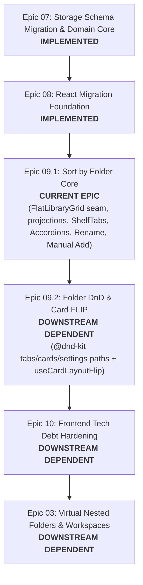

# PRD: Sort by Folder — Core View & Folder Management (09.1)

- **Change Mode:** `BROWNFIELD`
- **Reviewed-At-Commit:** `d5c5d81dfafd2ca1cc30704a7f6df56dbd8dbd56`
- **Upstream Prerequisite:** `docs/specs/08-react-migration/`

## Problem Statement
YumeShelf currently supports only flat library sort modes (`date`, `played`, `az`, `custom`), forcing users with multi-folder libraries to scroll a single undifferentiated grid and preventing direct folder-level browsing, renaming, or manual game addition into empty roots.

## Solution
Deliver a complete, independently shippable **Sort by Folder (Variant C)** browsing and folder-management experience without introducing drag-and-drop dependencies or touching `SettingsModal.tsx`:
1. **Preparatory Seam (`00`)**: Extract `FlatLibraryGrid.tsx` from `LibraryGrid.tsx`, harden Epic 09.1 IPC signatures (`getGames`, `setFolderAlias`, `addManualGame`), and register `'folder'` in `CANONICAL_SORT_OPTIONS`.
2. **Headless Section Projections (`01`)**: Project canonical root folders (`subsumeLibraryPaths`), dual favorite placement, and `$O(N \log N)$` custom-order sorting for `'folder'` mode in `library-sections.ts` and `library-stacks.ts`.
3. **Core Styles, Header & Locales (`02`)**: Add `"By Folder"` sort option in `Header.tsx`, non-drag styles in `folder-sort.css`, `--zIndex-shelf-tabs: 200`, and 4-language locale parity (`en`, `ja`, `zh`, `vi`).
4. **Segmented Shelf Tabs (`03`)**: Pure presentational `ShelfTabs.tsx` with pinned "All Folders" and "Favorites" tabs, folder tabs, roving `tabIndex`, zero-favorite fallback, and overflow chevron navigation.
5. **Collapsible Folder Accordions (`04`)**: `FolderAccordion.tsx`, `FolderSection.tsx`, and `FolderAccordionToolbar.tsx` with CSS Grid collapse transitions, `inert` collapsed grids, and `UiStorageAdapter`-backed persistence for `collapsed` and `activeTabId`.
6. **Inline Folder Rename & Empty Folder Manual Add (`05`)**: Pure presentational `FolderTitle.tsx` (single-click / `F2` rename) and `EmptyFolderPrompt.tsx` (native file picker ingestion + global empty state bypass) wired via coordinator callbacks in `LibraryGrid.tsx`.

## Dependency Lineage

## Intentional Deltas
> **Default Preserve (`BROWNFIELD`):** All existing observable behavior, contracts, and `initial intended UXUI` (including existing flat sort modes `date`, `played`, `az`, `custom`, `Header.tsx` controls, `GameCard.tsx` and `StackCard.tsx` styling/icons/right-click menu `useCardMenu.ts`, `SettingsModal.tsx` untouched in `09.1`, `useLocaleStrings()` 4-language resolution, and existing `--zIndex-*` tokens in `src/styles/theme.css`) default to **PRESERVE**; only deltas explicitly listed below may change.
- **`INTENTIONALLY_CHANGED`**:
  - Adding `'folder'` ("By Folder") sort mode option to `Header.tsx` and `CANONICAL_SORT_OPTIONS`.
  - Adding `FlatLibraryGrid`, `ShelfTabs`, `FolderAccordion`, `FolderSection`, `FolderAccordionToolbar`, `FolderTitle`, `EmptyFolderPrompt`, and `src/styles/folder-sort.css`.

## Testing Decisions
- Pure headless domain tests for `library-sections.ts` and `library-stacks.ts` across Windows, Linux, and macOS paths.
- Component tests via Vitest + `@testing-library/react` with injectable `UiStorageAdapter` and pure callbacks (`onTabSelect`, `onRenameFolder`, `onAddManualGame`).
- Terminal real-runtime smoke verification in Electron dev mode (`npm start`) in Ticket `05`.

## Out of Scope
- `@dnd-kit` installation, shelf tab drag reordering, multi-container card drag-and-drop, `useCardLayoutFlip`, and `SettingsLibraryTab` / `PathReorderList` (handled in [Epic 09.2](file:///d:/Projects/YumeShelf/docs/specs/09.2-folder-dnd-and-card-flip/PRD.md)).
- Remaining non-folder-sort renderer tech debt (handled or explicitly deferred in [Epic 10](file:///d:/Projects/YumeShelf/docs/specs/10-frontend-tech-debt-hardening/PRD.md)).
- Virtual nested folders and dual workspaces (deferred to [Epic 03](file:///d:/Projects/YumeShelf/docs/specs/03-virtual-nested-folders-and-workspaces/PRD.md)).

## Tickets
> **Critical Path:** `00 -> {01, 02} -> 03 -> 04 -> 05` (Tickets `01` and `02` depend strictly only on Ticket `00` and may be executed in parallel; Ticket `03` converges on both `01` and `02`.)

- `00` — [Preparatory Refactoring: Flat Grid Seam, Core IPC Contracts & Canonical Sort](file:///d:/Projects/YumeShelf/docs/specs/09.1-sort-by-folder-core/tickets/00-preparatory-flat-grid-and-core-ipc-seams.md)
- `01` — [Headless Library Section Projections & Library Stacks Custom Order](file:///d:/Projects/YumeShelf/docs/specs/09.1-sort-by-folder-core/tickets/01-headless-library-sections-and-stacks.md)
- `02` — [Folder Sort Core Styles, Header Option & 4-Language Locales](file:///d:/Projects/YumeShelf/docs/specs/09.1-sort-by-folder-core/tickets/02-folder-sort-styles-header-and-locales.md)
- `03` — [Segmented Shelf Tabs Core Component](file:///d:/Projects/YumeShelf/docs/specs/09.1-sort-by-folder-core/tickets/03-segmented-shelf-tabs-core.md)
- `04` — [Folder Accordions, Section Components & LibraryGrid Mounting](file:///d:/Projects/YumeShelf/docs/specs/09.1-sort-by-folder-core/tickets/04-folder-accordions-and-sections.md)
- `05` — [Inline Folder Rename, Empty Folder Manual Add & Runtime Smoke Gate](file:///d:/Projects/YumeShelf/docs/specs/09.1-sort-by-folder-core/tickets/05-inline-folder-rename-empty-manual-add-and-smoke.md)
