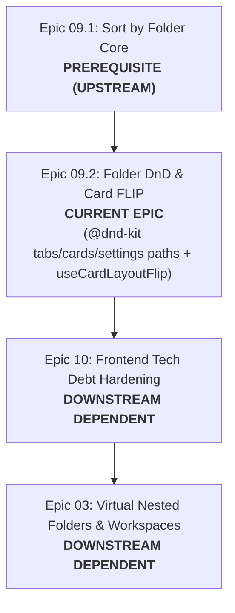

# PRD: Folder Drag-and-Drop Reordering & Card FLIP Animation (09.2)

- **Change Mode:** `BROWNFIELD`
- **Reviewed-At-Commit:** `d5c5d81`
- **Upstream Prerequisite:** `docs/specs/09.1-sort-by-folder-core/`

> [!NOTE]
> Because this PRD depends sequentially on `docs/specs/09.1-sort-by-folder-core/`, run `/prd-and-tickets !REC docs/specs/09.2-folder-dnd-and-card-flip/` after Epic 09.1 finishes review and implementation so 09.2 adapts to 09.1's final implemented seams.

## Problem Statement
After Epic 09.1 delivers core folder browsing, tabs, accordions, inline rename, and manual game addition, users still cannot reorder folder tabs, reorder game/stack cards across folders and Favorites via drag-and-drop, reorder library root paths in Settings, or see smooth card repositioning animations when toggling favorites or changing sort modes (a pre-310 UX regression from Epic 08).

## Solution
Layer `@dnd-kit` drag-and-drop reordering and non-drag layout FLIP animation cleanly on top of Epic 09.1's declarative components:
1. **Preparatory Seam & Dependencies (`00`)**: Install `@dnd-kit/core`, `@dnd-kit/sortable`, and `@dnd-kit/utilities`; extract `SettingsLibraryTab.tsx` from `SettingsModal.tsx` (removing orphaned `#hide-and-seek-select`); harden `updateLibraryConfig` in `ipc.d.ts`; add drag z-index tokens (`--zIndex-tab-drag: 500`, `--zIndex-card-drag: 1650`, `--zIndex-path-row-drag: 2100`) and 4-language drag locale keys.
2. **Shelf Tabs Horizontal Drag Reorder (`01`)**: Add `SortableTabItem.tsx` and wrap draggable folder tabs in `ShelfTabs.tsx` with horizontal `DndContext`/`SortableContext`, pinned-tab protection, `reorderLibraryPathsWithSubsumption`, and optimistic rollback.
3. **Multi-Container Game/Stack Card DnD & Layout FLIP (`02`)**: Mount `GameDndContext.tsx` strictly as a sibling outside `ShelfTabs`, enforce the 5-scenario drop validation matrix (`card-drop-validator.ts`) for both `GameCard` and `StackCard` (`SortableGameCard.tsx`), and restore non-drag card FLIP animation (`useCardLayoutFlip.ts`) strictly suppressed during active drags and container-scoped in `'folder'` sort.
4. **Settings Library Paths Vertical Drag Reorder & Smoke Gate (`03`)**: Mount `PathReorderList.tsx` and `SortablePathRow.tsx` inside `SettingsLibraryTab.tsx`, synchronize folder order reactively with `LibraryGrid.tsx`, and run the terminal runtime smoke check.

## Dependency Lineage

## Intentional Deltas
> **Default Preserve (`BROWNFIELD`):** All existing observable behavior, contracts, and `initial intended UXUI` (including all Epic 09.1 folder browsing, accordion collapse, inline rename, and manual add behaviors, existing flat sort modes, `GameCard`/`StackCard` styling and right-click menus `useCardMenu.ts`, and all other `SettingsModal.tsx` tabs and footer) default to **PRESERVE**; only deltas explicitly listed below may change.
- **`INTENTIONALLY_CHANGED`**:
  - Adding `@dnd-kit/core`, `@dnd-kit/sortable`, and `@dnd-kit/utilities` to `package.json`.
  - Adding drag-overlay z-index tokens, horizontal tab drag, multi-container card drag, vertical Settings path drag (`PathReorderList`), and restoring pre-310 non-drag card FLIP animation (`useCardLayoutFlip.ts`).

## Testing Decisions
- Pure unit tests for `card-drop-validator.ts` (5-scenario matrix across Windows/Linux/macOS) and `useCardLayoutFlip.test.tsx` (`!isDragging`, `prefers-reduced-motion: reduce`, container-scoped keys).
- Component tests for `ShelfTabs`, `GameDndContext`, `PathReorderList`, `SettingsModal`, `GameCard`, and `StackCard` via Vitest + `@testing-library/react`.
- Terminal real-runtime smoke check in Electron dev mode (`npm start`) in Ticket `03`.

## Out of Scope
- Core folder projection, accordions, inline rename, and manual game addition (delivered in [Epic 09.1](file:///d:/Projects/YumeShelf/docs/specs/09.1-sort-by-folder-core/PRD.md)).
- Remaining Settings tabs decomposition (`General`/`Updates`/`System`), `OverlayProvider` unification, and Save Editor / Mascot seams (handled in [Epic 10](file:///d:/Projects/YumeShelf/docs/specs/10-frontend-tech-debt-hardening/PRD.md)).
- Virtual nested folders and spring-loaded drag-and-drop (deferred to [Epic 03](file:///d:/Projects/YumeShelf/docs/specs/03-virtual-nested-folders-and-workspaces/PRD.md)).

## Tickets
- `00` — [Preparatory Refactoring: @dnd-kit Dependencies, Settings Library Tab & Drag Tokens](file:///d:/Projects/YumeShelf/docs/specs/09.2-folder-dnd-and-card-flip/tickets/00-preparatory-dnd-deps-settings-tab-and-tokens.md)
- `01` — [Shelf Tabs Horizontal Drag-and-Drop Reordering](file:///d:/Projects/YumeShelf/docs/specs/09.2-folder-dnd-and-card-flip/tickets/01-shelf-tabs-horizontal-dnd-reorder.md)
- `02` — [Multi-Container Game/Stack Card DnD & Non-Drag Layout FLIP](file:///d:/Projects/YumeShelf/docs/specs/09.2-folder-dnd-and-card-flip/tickets/02-game-card-dnd-cross-zone-and-card-flip.md)
- `03` — [Settings Library Paths Drag Reorder & Runtime Smoke Gate](file:///d:/Projects/YumeShelf/docs/specs/09.2-folder-dnd-and-card-flip/tickets/03-settings-paths-dnd-reorder-and-smoke.md)
