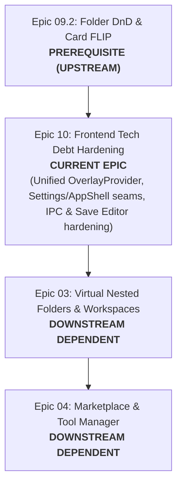

# PRD: Frontend Tech Debt Hardening

- **Change Mode:** `BROWNFIELD`
- **Reviewed-At-Commit:** `d5c5d81`
- **Upstream Prerequisite:** `docs/specs/09.2-folder-dnd-and-card-flip/`

## Problem Statement
Epic 08 replaced the legacy imperative renderer with declarative React components and Epics 09.1/09.2 extracted the flat-sort grid seam and Library settings tab. Several structural debts remain in the renderer that raise friction and regression risk for downstream Epics 03 (Virtual Nested Folders & Workspaces) and 04 (Marketplace & Tool Manager):
1. **Split modal ownership and duplicate Escape handling**: `OverlayProvider.tsx` manages most modals, while the delete confirmation modal (`pendingDeleteGame`) lives in local `App.tsx` state and both `OverlayProvider` and `Modal.tsx` bind `Escape` listeners.
2. **Remaining monolithic containers**: `SettingsModal.tsx` still concentrates General, Updates, and System tabs alongside modal shell state, and `App.tsx` carries dense card/library action orchestration.
3. **Residual untyped IPC and imperative Save Editor seams**: Several `ElectronAPI` methods in `src/shared/types/ipc.d.ts` still accept or return `any`, `SaveEditorApp.tsx` uses `document.querySelector` for keyboard shortcuts, and `save-editor-store.ts` silently swallows `storage.setItem` failures in `writePinnedIds`.
4. **Global event-bus coupling and undocumented deferral boundaries**: `SearchBar.tsx` and `MascotWidget.tsx` communicate through `window.dispatchEvent(new CustomEvent('yumeshelf:mascot-bonk'))`, while intentional deferrals (global CSS vs CSS Modules, imperative `mascot-widget.ts` core vs full React rewrite) lack explicit decision guardrails in source headers.

## Solution
Execute a focused, zero-UX-change structural hardening pass (`$S$`) placed directly after Epic 09.2 and before Epic 03:
1. Unify all modal state (including delete confirmation) inside `OverlayProvider.tsx` with a single `Escape` coordinator.
2. Finish decomposing `SettingsModal.tsx` into per-tab components and extract card/library action orchestration hooks out of `App.tsx`.
3. Replace remaining `any` signatures in `src/shared/types/ipc.d.ts`, replace `document.querySelector` shortcuts in `SaveEditorApp.tsx` with React refs/callbacks, and surface `writePinnedIds` storage failures explicitly.
4. Replace the `window` `CustomEvent` seam between `SearchBar.tsx` and `MascotWidget.tsx` with a typed callback/context seam, and document explicit architecture decision comments (current acceptance rationale + concrete upgrade triggers) at the top of `src/style.css`, `src/renderer/mascot-widget.ts`, and `src/renderer/components/MascotWidget.tsx`.

## Dependency Lineage

## Implementation Decisions
- **Single Modal Source of Truth**: Every modal (including delete confirmation) opens, closes, and restores focus through `OverlayProvider.tsx`; `Modal.tsx` delegates `Escape` dismissal to the provider rather than registering a competing global listener.
- **Thin Container Shells**: `SettingsModal.tsx` acts strictly as a tab container and dialog shell delegating to `SettingsGeneralTab`, `SettingsLibraryTab` (from Epic 09.2), `SettingsUpdatesTab`, and `SettingsSystemTab`. `App.tsx` delegates card/library mutations to dedicated hooks.
- **Zero `any` on `ElectronAPI`**: Every method in `src/shared/types/ipc.d.ts` uses explicit request/response interfaces.
- **Explicit Deferral Guardrails**: Files intentionally kept in their current architecture (`src/style.css`, `src/renderer/mascot-widget.ts`, `src/renderer/components/MascotWidget.tsx`) carry concise header comments stating why the current form is accepted and what concrete conditions make a future migration worth its cost.

## Intentional Deltas
> **Default Preserve (`BROWNFIELD`):** All existing observable behavior, contracts, and `initial intended UXUI` (including visual layout, CSS classes, keyboard shortcuts `Ctrl/Cmd+F`, `Ctrl/Cmd+S`, `Escape`, modal focus trapping/restoration, `useLocaleStrings()`, `useCardMenu`, Save Editor behavior, and mascot animations/interactions) default to **PRESERVE**; only deltas explicitly listed below may change.
- **`INTENTIONALLY_CHANGED`**: None on user-facing UXUI. All changes are internal structural seams, type contracts, diagnostic reporting, and source header comments.

## Testing Decisions
- Test through existing high-level Vitest + `@testing-library/react` seams with injectable `electronAPI`, `UiStorageAdapter`, `OverlayProvider`, and `SaveEditorStore`.
- Every ticket must keep existing component and integration suites green while adding targeted assertions for the hardened invariants (single `Escape` dismissal, delete modal through `OverlayProvider`, ref-based Save Editor shortcuts, `writePinnedIds` error reporting, and typed mascot trigger seam).

## Out of Scope
- Migrating global stylesheets (`src/style.css`, `src/styles/*.css`) to CSS Modules or CSS-in-JS (high blast radius and visual regression risk across all components; deferred until concrete class-collision or theming triggers occur).
- Rewriting the 763-line imperative `src/renderer/mascot-widget.ts` animation/physics controller into React (stable isolated subsystem with low churn; only the `CustomEvent` boundary with `SearchBar.tsx` is cleaned up).
- Any new user-facing features or visual redesigns.

## Tickets
- `01` — Unify Modal Ownership & Single Escape Coordinator (`tickets/01-unify-modal-ownership-and-escape-coordinator.md`)
- `02` — Decompose Remaining Settings Tabs & AppShell Orchestration (`tickets/02-decompose-settings-tabs-and-appshell-hooks.md`)
- `03` — Harden Remaining IPC Types & Save Editor Imperative Seams (`tickets/03-harden-ipc-types-and-save-editor-seams.md`)
- `04` — Decouple Mascot Event Seam & Document Deferral Guardrails (`tickets/04-decouple-mascot-event-seam-and-deferral-guardrails.md`)
