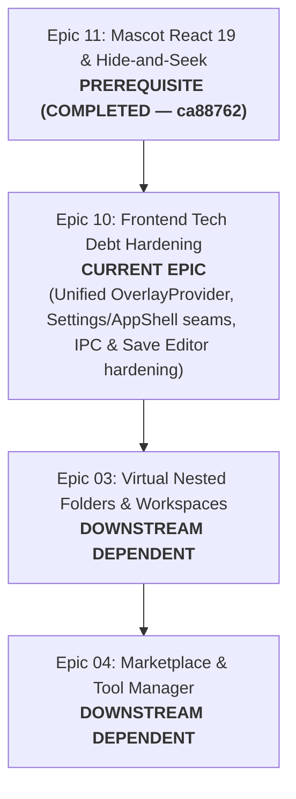
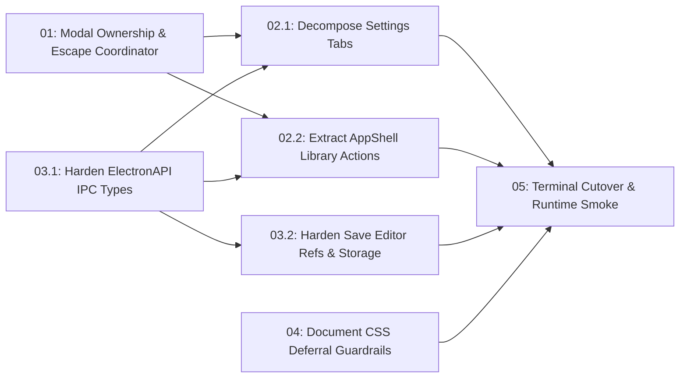

# PRD: Frontend Tech Debt Hardening

- **Change Mode:** `BROWNFIELD`
- **Review Status:** `REVIEWED`
- **Reviewed-At-Commit:** `858a108bc084be63c1f03d750e49c096ae8706b7`
- **Upstream Prerequisite:** `docs/specs/11-mascot-react-migration-and-hide-and-seek/` *(Completed in `ca88762` / PR #329)*

## Problem Statement
Epic 08 replaced the legacy imperative renderer with declarative React components and Epics 09.1/09.2 extracted the flat-sort grid seam and Library settings tab. Several structural debts remain in the renderer that raise friction and regression risk for downstream Epics 03 (Virtual Nested Folders & Workspaces) and 04 (Marketplace & Tool Manager):
1. **Split modal ownership and duplicate Escape handling**: `OverlayProvider.tsx` manages most modals, while the delete confirmation modal (`pendingDeleteGame`) lives in local `App.tsx` state and both `OverlayProvider` and `Modal.tsx` bind `Escape` listeners.
2. **Remaining monolithic containers**: `SettingsModal.tsx` still concentrates General (including `autoAllowLargeSaves`), Updates, and System (including `useOptionalMascot()` and `#hide-and-seek-select` landed in Epic 11) tabs alongside modal shell state, and `App.tsx` carries dense card/library action orchestration.
3. **Residual untyped IPC and imperative Save Editor seams**: Several `ElectronAPI` methods in `src/shared/types/ipc.d.ts` (and `src/preload.ts`) still accept or return `any`, `SaveEditorApp.tsx` uses `document.querySelector` for keyboard shortcuts, and `save-editor-store.ts` silently swallows `storage.setItem` failures in `writePinnedIds`.
4. **Undocumented CSS deferral boundary**: Intentional deferral of global CSS vs CSS Modules lacks explicit decision guardrails in `src/style.css` (React 19 Mascot migration and `yumeshelf:mascot-bonk` removal have already landed in Epic 11).

## Solution
Execute a focused, zero-UX-change structural hardening pass (`$S$`) after Epic 11 (`v2.3.0`) and before Epic 03:
1. Unify all modal state (including delete confirmation) inside `OverlayProvider.tsx` with a single `Escape` coordinator (`registerDismissHandler` + `useOptionalOverlay`) preserving per-modal busy guards, IME composition safety, and focus restoration.
2. Replace remaining `any` signatures in `src/shared/types/ipc.d.ts` and `src/preload.ts` (aligning live callers such as `renameCategory` and `setAutoLaunch` in `SettingsModal.tsx`), replace `document.querySelector` shortcuts in `SaveEditorApp.tsx` with React refs/callbacks, and surface `writePinnedIds` storage failures via both sanitized `console.warn` and an optional `onStorageError` callback.
3. Finish decomposing `SettingsModal.tsx` into pure-presentational per-tab components (keeping shared modal-open state, system IPC handlers, `autoAllowLargeSaves` state, and Epic 11 Mascot/Hide-and-Seek orchestration in `SettingsModal.tsx`) and extract card/library action orchestration (`useLibraryActions.ts` + pure `recalculateAfterGameDeletion`) out of `App.tsx`.
4. Document explicit architecture decision comments (current acceptance rationale + concrete upgrade triggers) at the top of `src/style.css`, and converge with a full automated + real-runtime Electron smoke gate (`05`).

## Dependency Lineage

## Implementation Decisions
- **Single Modal Source of Truth**: Every modal (including delete confirmation) opens, closes, and restores focus through `OverlayProvider.tsx`; `Modal.tsx` delegates `Escape` dismissal to the provider via `useOptionalOverlay()` and `registerDismissHandler(type, handler)` when provider-coordinated while retaining local `Escape` fallback for standalone `<Modal>` instances (e.g. Save Editor dialogs and unit tests).
- **Thin Container Shells**: `SettingsModal.tsx` acts as the modal shell owning shared modal-lifetime state, system IPC handlers, and Mascot/Hide-and-Seek persistence while delegating rendering to pure-presentational `SettingsGeneralTab`, `SettingsLibraryTab` (from Epic 09.2), `SettingsUpdatesTab`, and `SettingsSystemTab`. `App.tsx` delegates card/library mutations to `useLibraryActions.ts`.
- **Zero `any` on `ElectronAPI` & `preload.ts`**: Every method in `src/shared/types/ipc.d.ts` uses explicit request/response interfaces declared directly inside `src/shared/types/ipc.d.ts` (preserving `NodeNext` `.js` relative imports and zero `src/main/` or `src/renderer/` imports), matched across `src/preload.ts` and `SettingsModal.tsx`.
- **Explicit Deferral Guardrails**: `src/style.css` carries a concise header comment stating why global feature-scoped CSS is accepted today and what concrete conditions make a future CSS Modules migration worth its cost, without referencing retired stylesheet filenames (`welcome.css`, `stack-overlay.css`, `telemetry-modal.css`).

## Intentional Deltas
> **Default Preserve (`BROWNFIELD`):** All existing observable behavior, contracts, and `initial intended UXUI` (including visual layout, CSS classes, keyboard shortcuts `Ctrl/Cmd+F`, `Ctrl/Cmd+S`, `Shift+Enter`, `Escape`, modal focus trapping/restoration, `useLocaleStrings()`, `useCardMenu`, Save Editor behavior, and mascot animations/interactions) default to **PRESERVE**; only deltas explicitly listed below may change.
- **`INTENTIONALLY_CHANGED`**: None on user-facing UXUI. All changes are internal structural seams, type contracts, diagnostic reporting, and source header comments.

## Testing Decisions
- Test through existing high-level Vitest + `@testing-library/react` seams with injectable `electronAPI`, `UiStorageAdapter`, `OverlayProvider`, and `SaveEditorStore`.
- Every ticket must keep existing component and integration suites green while adding targeted assertions for the hardened invariants (single `Escape` dismissal, delete modal through `OverlayProvider`, ref-based Save Editor shortcuts, `writePinnedIds` sanitized logging + `onStorageError`, `useLibraryActions` isolation, and `SettingsModal` tab-switch persistence).
- Terminal ticket `05` executes the full automated pipeline (`npm test && npm run typecheck && npm run build:preload && npm run build:vite && npm run verify:no-ts-nocheck`) plus a real-runtime Electron smoke check (`npm start`).

## Out of Scope
- Migrating global stylesheets (`src/style.css`, `src/styles/*.css`) to CSS Modules or CSS-in-JS (high blast radius and visual regression risk across all components; deferred until concrete class-collision or theming triggers occur).
- Modifying the Mascot widget or Hide-and-Seek subsystem behavior (already migrated to React 19 in Epic 11).
- Any new user-facing features or visual redesigns.

## Tickets

### Execution DAG & Critical Path
- **Primary Bottleneck Critical Path**: `01 / 03.1 -> 02.2 -> 05` *(co-equal 3-wave topological depth with `01 / 03.1 -> 02.1 -> 05` and `03.1 -> 03.2 -> 05`)*.
- **Wave 1 (`Blocked by: None`)**: `01`, `03.1`, `04` *(Note: `01` adds `modalType="settings"` on `<Modal>` in `SettingsModal.tsx` and `03.1` updates `handleRenameCategorySubmit` / `handleAutoLaunchChange` in `SettingsModal.tsx`; do not execute `01` and `03.1` concurrently against `SettingsModal.tsx` in parallel worktrees).*
- **Wave 2**: `02.1` (`Blocked by: 01, 03.1`), `02.2` (`Blocked by: 01, 03.1`), `03.2` (`Blocked by: 03.1`) *(strictly disjoint file sets; may execute in parallel).*
- **Wave 3 (Terminal Cutover)**: `05` (`Blocked by: 02.1, 02.2, 03.2, 04`).

### Ticket Manifest
- `01` — Unify Modal Ownership & Single Escape Coordinator (`tickets/01-unify-modal-ownership-and-escape-coordinator.md`)
- `02.1` — Decompose Remaining Settings Tabs (`tickets/02.1-decompose-settings-tabs.md`)
- `02.2` — Extract AppShell Library Actions Hook (`tickets/02.2-extract-appshell-library-actions.md`)
- `03.1` — Harden ElectronAPI IPC Types & Preload Boundary (`tickets/03.1-harden-electron-api-ipc-types.md`)
- `03.2` — Harden Save Editor Refs & Storage Error Reporting (`tickets/03.2-harden-save-editor-refs-and-storage.md`)
- `04` — Document Global CSS Deferral Guardrails (`tickets/04-document-css-deferral-guardrails.md`)
- `05` — Terminal Cutover & Real-Runtime Smoke Gate (`tickets/05-terminal-cutover-and-runtime-smoke.md`)
