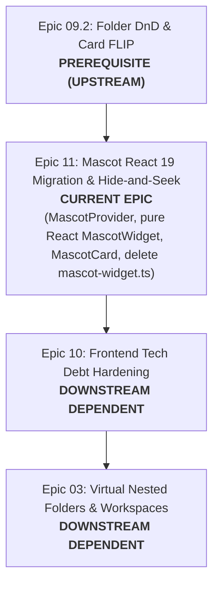

# PRD: Mascot React 19 Migration & Hide-and-Seek Restoration

- **Change Mode:** `BROWNFIELD`
- **Reviewed-At-Commit:** `e963d26`
- **Upstream Prerequisite:** `docs/specs/09.2-folder-dnd-and-card-flip/`

## Problem Statement
1. **Regressed Hide-and-Seek Feature**: During Epic 08's legacy DOM decommissioning, `src/renderer/features/hide-and-seek.ts` was deleted while leaving `#hide-and-seek-select` in `SettingsModal.tsx` and `returnFromHideAndSeek` in `mascot-widget.ts` orphaned with zero runtime behavior.
2. **Imperative Mascot Seam & Global Event Bus**: `MascotWidget.tsx` is currently a thin wrapper mounting a 763-line imperative DOM controller (`src/renderer/mascot-widget.ts`) inside `useEffect`, communicating with `SearchBar.tsx` through `window.dispatchEvent(new CustomEvent('yumeshelf:mascot-bonk'))` and `'yumeshelf:mascot-recover'`. Restoring Hide-and-Seek cleanly requires sharing reactive state across `SettingsModal`, `MascotWidget`, `LibraryGrid`, and `SearchBar`.

## Solution
Migrate the entire Mascot and Hide-and-Seek subsystem to declarative React 19 + TypeScript (`MascotProvider`, `MascotWidget`, `MascotCard`), eliminating `src/renderer/mascot-widget.ts` and `window` `CustomEvent` coupling while restoring 100% of `pre-310` `initial intended UXUI`:
1. **Mascot Domain Core & `MascotProvider` (`01`)**: Extract pure shuffled-deck helpers, bonk/quote state transitions, and injectable audio/storage adapters, plus `MascotProvider` owning `show`, `scale`, `sound`, `volume`, `hideAndSeek`, `isDismissed`, `bonkCount`, and cooldown continuity.
2. **Pure React `MascotWidget` & Context Menu (`02`)**: Replace imperative `createMascotWidget` inside `MascotWidget.tsx` with declarative React drag positioning, `BONK.png` impact effects, recovery timers, and `#mascot-context-menu`, then delete `src/renderer/mascot-widget.ts`.
3. **Restore Hide-and-Seek `<MascotCard />`, `LibraryGrid` & `SearchBar` (`03`)**: Implement `<MascotCard />` (`smug`/`bonked`/`bonkedTooMuch`, 10s idle quote rotation, squash animation, `5..10` click threshold dismissal -> `returnFromHideAndSeek`), inject into `LibraryGrid.tsx`, and surface in `SearchBar.tsx`.
4. **Settings Sync & Runtime Smoke Gate (`04`)**: Wire `#mascot-show-select` and `#hide-and-seek-select` to `MascotProvider` for immediate visibility/grid synchronization, update test suites, and run the terminal runtime smoke check.

## Dependency Lineage

## Intentional Deltas
> **Default Preserve (`BROWNFIELD`):** All existing observable behavior, DOM IDs/CSS classes (`src/styles/mascot.css`, `src/styles/game-cards.css`), storage keys (`yumeshelf_mascot_*`, `yumeshelf_hide_and_seek`, `yumeshelf_deck_*`), SFX assets, and `pre-310` Hide-and-Seek `initial intended UXUI` (`.scratch/pre-310-frontend/src/renderer/features/hide-and-seek.ts`) default to **PRESERVE**; only deltas explicitly listed below may change.
- **`INTENTIONALLY_CHANGED`**:
  - Replacing the imperative `src/renderer/mascot-widget.ts` DOM controller and `window` `CustomEvent('yumeshelf:mascot-bonk' | 'yumeshelf:mascot-recover')` bus with declarative React 19 (`MascotProvider`, `MascotWidget`, `MascotCard`).
  - Restoring Hide-and-Seek (`#hide-and-seek-select` `"YEAAA"` / `"I'm out"` functionality) into `LibraryGrid` and `SearchBar`.

## Testing Decisions
- Pure unit tests for shuffled-deck persistence, bonk streak/cooldown math, and `MascotProvider` state transitions using injectable `UiStorageAdapter` and mocked audio player.
- Component/integration tests via Vitest + `@testing-library/react` across `MascotWidget`, `MascotCard`, `SearchBar`, `LibraryGrid`, and `SettingsModal`.
- Terminal real-runtime smoke verification in Electron dev mode (`npm start`) in Ticket `04`.

## Out of Scope
- Changing mascot artwork, audio assets, or visual styling outside `pre-310` parity.
- Virtual nested folders or workspace features (Epic 03).

## Tickets
> **Critical Path:** `01 -> 02 -> 03 -> 04`

- `01` — [Mascot Domain Core, Shuffled Decks & `MascotProvider` ($S$)](file:///d:/Projects/YumeShelf/docs/specs/11-mascot-react-migration-and-hide-and-seek/tickets/01-mascot-domain-and-provider.md)
- `02` — [Pure React `MascotWidget` & Context Menu Migration ($B$)](file:///d:/Projects/YumeShelf/docs/specs/11-mascot-react-migration-and-hide-and-seek/tickets/02-pure-react-mascot-widget-migration.md)
- `03` — [Restore Hide-and-Seek `<MascotCard />`, `LibraryGrid` & `SearchBar` Seams ($B$)](file:///d:/Projects/YumeShelf/docs/specs/11-mascot-react-migration-and-hide-and-seek/tickets/03-restore-hide-and-seek-card-and-search.md)
- `04` — [Wire Settings Mascot/Hide-and-Seek Sync & Runtime Smoke Gate ($B$)](file:///d:/Projects/YumeShelf/docs/specs/11-mascot-react-migration-and-hide-and-seek/tickets/04-settings-sync-and-runtime-smoke.md)
