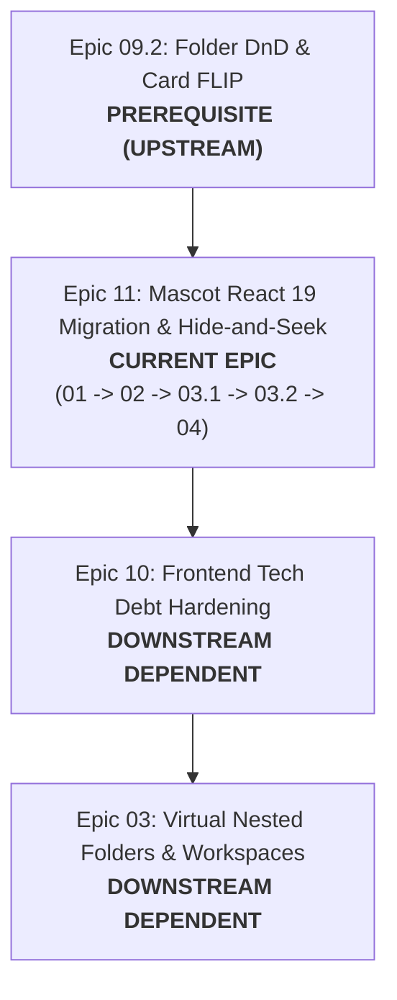

# PRD: Mascot React 19 Migration & Hide-and-Seek Restoration

- **Review Status:** `REVIEWED`
- **Change Mode:** `BROWNFIELD`
- **Reviewed-At-Commit:** `94b495823510be06379f53f53daa1c5a6d7b4f56`
- **Upstream Prerequisite:** `docs/specs/09.2-folder-dnd-and-card-flip/`

## Problem Statement
1. **Regressed Hide-and-Seek Feature**: During Epic 08's legacy DOM decommissioning, `src/renderer/features/hide-and-seek.ts` was deleted while leaving `#hide-and-seek-select` in `SettingsModal.tsx` and `returnFromHideAndSeek` in `mascot-widget.ts` orphaned with zero runtime behavior.
2. **Imperative Mascot Seam & Global Event Bus**: `MascotWidget.tsx` is currently a thin wrapper mounting a 763-line imperative DOM controller (`src/renderer/mascot-widget.ts`) inside `useEffect`, communicating with `SearchBar.tsx` through `window.dispatchEvent(new CustomEvent('yumeshelf:mascot-bonk'))` and `'yumeshelf:mascot-recover'`. Restoring Hide-and-Seek cleanly requires sharing reactive state across `SettingsModal`, `MascotWidget`, `LibraryGrid`, and `SearchBar`.

## Solution
Migrate the entire Mascot and Hide-and-Seek subsystem to declarative React 19 + TypeScript (`MascotProvider`, `<BonkImpactLayer />`, `MascotWidget`, `MascotCard`), eliminating `src/renderer/mascot-widget.ts` and `window` `CustomEvent` coupling while restoring 100% of `pre-310` `initial intended UXUI`:
1. **Mascot Domain Core & `MascotProvider` (`01`)**: Extract pure `MascotRecoveryState` discriminated-union FSM transitions, `MASCOT_STORAGE_KEYS` boundary ingress parsers (`parseMascotPreferences`, `parseMascotPosition`, `parseBonkCount`, `getNextShuffledIndex`), injectable `MascotAudioPlayer` (`play`/`stop`), and `MascotTimingConfig` seams; implement `MascotProvider` owning selector-isolated store slices (`useMascot`, `useOptionalMascot`, `useOptionalMascotHideAndSeek`, `useOptionalMascotSearch`), shared Hide-and-Seek session identity (`cardTitleIndex`, `isCardStarred`, `sessionSlotFraction`, `hideAndSeekThreshold`), unified bonk/drag/cooldown timers, and the shared `<BonkImpactLayer />` portal.
2. **Pure React `MascotWidget`, `App` Provider Mount & Legacy Decommissioning (`02`)**: Replace imperative `createMascotWidget` inside `MascotWidget.tsx` with declarative React drag positioning (`yumeshelf_mascot_x` / `yumeshelf_mascot_y`), `#mascot-context-menu`, and `MascotProvider` bonk/impact delegation; mount `<MascotProvider storage={effectiveStorage}>` wrapping `<AppShell />` in `App.tsx` (with a transitional `onMascotSettingsChanged` -> `updatePreferences` bridge); remove `CustomEvent` listeners from `SearchBar.tsx`; migrate `MascotWidget.test.tsx`, `SearchBar.test.tsx`, and `entrypoint-cutover.test.tsx`; and delete `src/renderer/mascot-widget.ts` and `src/renderer/mascot-widget.test.ts`.
3. **Folder Tab & Accordion Mascot Slot Seams (`03.1`, $S$)**: Add display-only `MascotGridSlot`, `allowEmptyFavoritesTab`, and `hasVirtualFavorite` seams across `library-sections.ts`, `ShelfTabs.tsx`, `FolderAccordion.tsx`, and `FolderSection.tsx` without polluting `useStableItemIds`, `SortableContext`, `.library-section-count`, or `yumeshelf_collapsed_folders`.
4. **Restore Hide-and-Seek `<MascotCard />`, `LibraryGrid` & `SearchBar` Integration (`03.2`, $B$)**: Implement `<MascotCard />` (`smug`/`bonked`/`bonkedTooMuch`, 10s idle quote rotation, squash animation, `BONK.png` impact via `MascotProvider.bonk`, `5..10` threshold dismissal -> `returnFromHideAndSeek`), inject `MascotGridSlot` into `LibraryGrid.tsx` (unpolluted `GameDndContext` / `yumeshelf_custom_order`, FLIP `structuralLayoutRevision`, exhaustive `effectiveTabId` routing, focus handoff), and surface/locate `MASCOT_CARD_KEY` in `SearchBar.tsx`.
5. **Settings Sync, Bridge Retirement & Runtime Smoke Gate (`04`)**: Wire `SettingsModal.tsx` (`#mascot-show-select`, `#hide-and-seek-select`, scale, sound, volume) directly to `MascotProvider` via `useOptionalMascot()`, retire the transitional `App.tsx` `onMascotSettingsChanged` bridge and `MascotPreferences` import, update `SettingsModal.test.tsx`, and run full automated tests (`npm test && npm run typecheck && npm run build:vite`) plus the terminal Electron runtime smoke check (`npm start`).

## Dependency Lineage

## Intentional Deltas
> **Default Preserve (`BROWNFIELD`):** All existing observable behavior, DOM IDs/CSS classes (`src/styles/mascot.css`, `src/styles/game-cards.css`), storage keys (`yumeshelf_mascot_*`, `yumeshelf_hide_and_seek`, `yumeshelf_deck_*`), SFX assets, and `pre-310` Hide-and-Seek `initial intended UXUI` (`.scratch/pre-310-frontend/src/renderer/features/hide-and-seek.ts`) default to **PRESERVE**; only deltas explicitly listed below may change.
- **`INTENTIONALLY_CHANGED`**:
  - Replacing the imperative `src/renderer/mascot-widget.ts` DOM controller and `window` `CustomEvent('yumeshelf:mascot-bonk' | 'yumeshelf:mascot-recover')` bus with declarative React 19 (`MascotProvider`, `<BonkImpactLayer />`, `MascotWidget`, `MascotCard`).
  - Restoring Hide-and-Seek (`#hide-and-seek-select` `"YEAAA"` / `"I'm out"` functionality) into `LibraryGrid`, `ShelfTabs`, `FolderAccordion`, `FolderSection`, and `SearchBar`.

## Testing Decisions
- Pure unit tests for `MascotRecoveryState` FSM transitions, `MASCOT_STORAGE_KEYS` ingress parsers, shuffled-deck persistence, and `MascotProvider` selector isolation / `<BonkImpactLayer />` portal & `rAF` cleanup using injectable `UiStorageAdapter`, `MascotAudioPlayer`, `nowProvider`, and `rng`.
- Component/integration tests via Vitest + `@testing-library/react` across `MascotWidget`, `ShelfTabs`, `FolderAccordion`, `MascotCard`, `SearchBar`, `LibraryGrid`, `Header`, `entrypoint-cutover`, and `SettingsModal`.
- Terminal real-runtime smoke verification in Electron dev mode (`npm start`) in Ticket `04`.

## Out of Scope
- Changing mascot artwork, audio assets, or visual styling outside `pre-310` parity.
- Virtual nested folders or workspace features (Epic 03).

## Tickets
> **Critical Path:** `01 -> 02 -> 03.1 -> 03.2 -> 04`

- `01` — [Mascot Domain Core, Shuffled Decks & `MascotProvider` ($S$)](file:///d:/Projects/YumeShelf/docs/specs/11-mascot-react-migration-and-hide-and-seek/tickets/01-mascot-domain-and-provider.md)
- `02` — [Pure React `MascotWidget`, Context Menu & Legacy Decommissioning ($B$)](file:///d:/Projects/YumeShelf/docs/specs/11-mascot-react-migration-and-hide-and-seek/tickets/02-pure-react-mascot-widget-migration.md)
- `03.1` — [Folder Tab & Accordion Mascot Slot Seams ($S$)](file:///d:/Projects/YumeShelf/docs/specs/11-mascot-react-migration-and-hide-and-seek/tickets/03.1-folder-tab-and-accordion-mascot-slot-seams.md)
- `03.2` — [Restore Hide-and-Seek `<MascotCard />`, `LibraryGrid` & `SearchBar` Integration ($B$)](file:///d:/Projects/YumeShelf/docs/specs/11-mascot-react-migration-and-hide-and-seek/tickets/03.2-restore-hide-and-seek-card-and-search.md)
- `04` — [Wire Settings Mascot/Hide-and-Seek Sync, Retire Bridge & Runtime Smoke Gate ($B$)](file:///d:/Projects/YumeShelf/docs/specs/11-mascot-react-migration-and-hide-and-seek/tickets/04-settings-sync-and-runtime-smoke.md)
